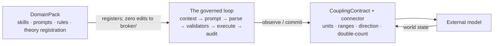

# WAGF — a governance layer for language-model agents in coupled human–water models

<div align="center">

[](https://www.python.org/downloads/)
[](LICENSE)
[](https://github.com/WenyuChiou/WAGF/actions/workflows/test.yml)

[**English**](README.md) | [**中文**](README_zh.md)

</div>

A coupled human–water model needs a decision rule for the people in it. WAGF
lets that rule be a language model, and then does the thing a language model
cannot do for itself: it checks each proposed action against what the basin
physically and institutionally permits, checks it against the theory the study
claims to be using, sends the failures back to the model with a reason, and
writes down every step. This is the follow-up to the group's WRR 2026 LLM-ABM
flood study, which showed that language agents can be run inside a hydrological
model at all. Three things that study did not have are what this repository
adds: a **hard-rule layer** that refuses a proposal on physical or institutional
feasibility and logs the refusal, a **soft rule layer** that compares the action
against the appraisal the model wrote in the same answer, and a **declared
contract** at the boundary to the physical model.

WAGF is a framework, and what it delivers is the hosting: **a case plugs in
through a `DomainPack` — its skills, prompts, rules and theory registration —
and its physical model plugs in through a `CouplingContract` and a connector,
and the governed loop below then runs unchanged.** Those two are the only plug
points. Everything under `examples/` is a thin demonstration that one of them
holds, not a study; the studies live in their own papers and cite the corpus
they used.

## How one decision moves through the framework

```mermaid
flowchart LR
  ENV["Environment /<br/>physical model"]
  CTX["Context providers<br/>state · memory · history"]
  SOC["Social feed provider"]
  PRM["Prompt<br/>persona + numbered options + JSON schema"]
  DEC["Decider<br/>llm / rule_based / parametric / hybrid"]
  PAR["Parser<br/>layered; numeric id → skill name"]
  VAL["Validators — one pass<br/>hard ERROR + soft WARNING"]
  ADV["Advise channel<br/>off / record / feedback"]
  RTY{"retries left?"}
  FB["Re-prompt with the rule's reason"]
  DEF["Registry default skill"]
  EXE["Executed skill"]
  CPL["Coupling adapter<br/>contract checks"]
  STP["Physical model step<br/>mass balance, state update"]
  MEM["Memory write-back + reflection"]
  AUD["Audit row<br/>raw/*.jsonl + governance_audit.csv"]
  INT["run_integrity.json<br/>reproducibility_manifest.json"]

  ENV -->|"one snapshot per period"| CTX
  SOC -.->|"posts"| CTX
  CTX -->|"rendered fields"| PRM
  PRM -->|"one call"| DEC
  DEC -->|"raw text"| PAR
  PAR -->|"proposal + construct labels"| VAL
  VAL -->|"findings"| ADV
  ADV -->|"feeds retry decision"| RTY
  RTY -->|"yes"| FB
  RTY -->|"exhausted"| DEF
  FB -->|"same context, added reason"| PRM
  DEF --> EXE
  VAL -->|"approved"| EXE
  EXE --> MEM
  MEM --> CTX
  EXE --> AUD
  AUD --> INT
  EXE -.->|"end of period, aggregated"| CPL
  CPL -->|"period commit"| STP
  STP -->|"next period"| ENV

  classDef optional stroke-dasharray:5 5,color:#555;
  class SOC,ADV,CPL optional;
```



**Dashed nodes are default-OFF flags.** The social feed provider needs
`global_config.social_feeds.enable`; the advise channel needs
`governance.advise_mode: record` or `feedback`; the coupling adapter needs an
`ExperimentBuilder.with_coupling(...)` binding. With all three off — which is
how every published run was produced — the loop is
context → prompt → parse → validators (hard ERROR + soft WARNING, one pass) →
execute → audit, with the advise pass and the coupling adapter both no-ops.

The retry loop reads blocking errors only. A WARNING approves and executes; it
reaches the model only when `advise_mode: feedback` turns it into one extra,
non-blocking prompt. That is a property of the architecture, not a measurement
(see Limitations).

### The two plug points

Nothing in the loop above is written per case. A case enters on the left, a
physical model enters on the right, and the box between them is the shipped
framework.



| Connector archetype | The model is | Status |
|---|---|---|
| **A** — in-process solver | A BMI-conformant object WAGF calls each period, or each of K sub-steps | Ready |
| **B** — file replay | A table of period → value, or a recorded trace | Pattern only; ~30 lines copied from `examples/cat_model/`, no shipped class |
| **C** — subprocess | A separate program spoken to over stdin/stdout JSON, once per period | Ready. REST over the same guard is deferred — no consumer yet |
| **D** — another ABM, two-way | A peer model exchanging state at period end | Ready for period-lagged exchange only |
| **E** — callback, *the external model owns the loop* | A model that runs its own time stepping and calls WAGF when it needs a human decision | **Planned.** Roadmap P2 / P3; the intended first host is HydroCNHS, whose daily rainfall-runoff loop cannot be driven from outside |

Archetypes A–D all assume WAGF advances time and asks the model for the world.
E inverts that, which is why it is a separate archetype and not a variant, and
why no shipped example uses it yet.

## What a governed decision actually looks like

One real decision from the frozen irrigation corpus: seed 42, year 7 of 42,
agent `AgUsesAboveFontenelle_AgAbvFontenellePL`, a 4,000-acre small-grains
operation in the Upper Basin with an 800,000 AF water right. Print it yourself:

```bash
python - <<'PY'
import json
p = "examples/irrigation_abm/results/production_v21_42yr_seed42/raw/irrigation_farmer_traces.jsonl"  # frozen v21 gemma3:4b corpus, obtained from the authors (reproduction/README.md); not regenerated by a fresh run
for line in open(p, encoding="utf-8"):
    d = json.loads(line)
    if d["step_id"] == 491:
        print(d["input"]); print(d["raw_output"])
        print(d["validation_issues"]); print(d["approved_skill"], d["outcome"], d["retry_count"])
        break
PY
```

**1 — Context.** The environment publishes the period's state and the context
providers render it into the prompt: precipitation 150 mm, no shortage declared,
current use 191,722 AF against the 800,000 AF right (24 % utilisation), a
five-year request-and-supply table, and the three memories the memory engine
retrieved, one of them a consolidated reflection from a year when a large
request went unmet.

**2 — Prompt.** The action menu is rendered as numbered options, and the model
is asked to return the *number*, not the name:

```
1. Aggressively increase water demand (8-20% change) ...
2. Cautiously increase water demand (1-8% change) ...
3. Maintain current water demand level ...
4. Cautiously reduce water demand (1-8% change) ...
5. Aggressively reduce water demand (8-20% change) ...
```

It is also asked for two appraisal labels on a VL–VH scale before it chooses:
water scarcity (WSA) and adaptive capacity (ACA).

**3 — Proposal.** The parser reads the JSON block, maps the numeric id back to a
registered skill name through the same option map that rendered the menu, and
builds a `SkillProposal` carrying the skill, the reasoning text and the two
labels.

**4 — Validators.** The proposal to increase demand hits a hard rule:

```
IrrigationDemandCeilingValidator / demand_ceiling_stabilizer
  Demand increase blocked: basin-wide aggregate demand (6.09 MAF) exceeds
  the 6.0 MAF stability ceiling by 1.4%.
```

That rule reads the world, not the model's own words: `total_basin_demand` is
computed by the environment from every agent's request. The other hard rule in
this domain that reads the world is `water_right_cap`, a per-agent precondition
from the Colorado River Compact allocation. Alongside them sit the theory rules
(`low_threat_no_increase`, `high_threat_high_cope_no_increase`,
`high_threat_no_maintain`) which read the model's own WSA and ACA labels and
ask whether the action is consistent with them. The last of those three is a
WARNING; on this decision it did not fire.

**5 — Retry.** The broker re-prompts with the rule's message attached. The
second answer changes course and quotes the reason back:

> "The basin-wide aggregate demand is already high at 6.09 MAF, and the
> stability ceiling is only 6.0 MAF. The governance layer flagged a 1.4 %
> overage. … I'll stick with the status quo."

`retry_count = 1`, `outcome = RETRY_SUCCESS`.

**6 — Executed.** `maintain_demand` is approved and executed by the simulation
engine, holding the request at 191,722 AF. Had the retries run out, the registry
default would have executed instead and the audit row would say so.

**7 — Physical step.** The request enters the basin mass balance — the surrogate
CRSS reservoir model that carries Lake Mead storage, shortage tier and the
drought index forward — and next year's context is drawn from the result.

**8 — Audit row.** One JSONL record and one CSV row: the rendered prompt, the
raw output, the parsed labels, `failed_rules`, `retry_count`, the approved
skill, the execution result, and the memory that was retrieved. Runs at
current HEAD also write `reproducibility_manifest.json` (git commit, model
digest, seeds, config hash), `config_snapshot.yaml`, `run_integrity.json`, the
`.schema.json` sidecar and `validator_health.csv`. This frozen v21 corpus
predates the last three: its run directory has `audit_summary.json`,
`config_snapshot.yaml`, `governance_summary.json`, `reflection_log.jsonl`,
`reproducibility_manifest.json` and `simulation_log.csv` — no
`run_integrity.json`, schema sidecar or `validator_health.csv`.

**What that row does not contain**, and it matters: the *first* proposal. Today
one JSONL record covers one decision, so `raw_output` is the last attempt and
`failed_rules` is the union over attempts. Attempt-level records are the first
item on the roadmap.

## Quickstart

Everything here runs on a fresh clone with no GPU, no network and no API key.

```bash
git clone https://github.com/WenyuChiou/WAGF.git && cd WAGF
pip install -e .

# 1. scaffold a domain from nothing
python -m broker.tools.scaffold_domain my_domain --skills "action_a,action_b"

# 2. check the generated prompt and rules before spending a token
python -m broker.tools.validate_prompt examples/my_domain_demo/config/agent_types.yaml

# 3. run it against the mock model
python examples/my_domain_demo/run_experiment.py --model mock --years 1 --agents 1

# 4. change something, run it again, and diff the two audit CSVs
python -m broker.tools.compare_audit_csv <before>/…_governance_audit.csv \
                                         <after>/…_governance_audit.csv
```

Steps 1–3 are the `scaffold-smoke` job in CI, run verbatim on pushes to
`main`, `refactor/**` and `stack/**` and on pull requests into `main` and
`stack/**` (`.github/workflows/test.yml:3-7`), so a broken front door fails
the build rather than the reader.

Step 4 is the byte-identity gate the project runs on every framework change: the
flood and irrigation mock recipes must produce a CSV that `compare_audit_csv`
calls identical to the frozen baseline. Use that tool rather than a raw sha256 —
`mem_top_source` is derived through set iteration and can vary with
`PYTHONHASHSEED`, which a hash cannot tell apart from a real change.

Real models, when you want them:

```bash
ollama pull gemma3:4b
python examples/single_agent/run_flood.py --model gemma3:4b --years 3 --agents 10
```

Cloud backends are reachable today as `--model anthropic:<id>`, `openai:<id>` or
`gemini:<id>` with the matching key in the environment. They have no retry
backoff by default and record no token usage or cost; that is roadmap P1, and
no published run used them.

Tests: `python -m pytest tests/ broker/ -ra --tb=short --continue-on-collection-errors -k "not real_llm"`
— the same line CI runs.

## Cases the framework hosts

Each row is a thin demonstration that one plug point holds, not a study. Read
the middle column first: it says which part of the framework the case exists to
exercise. The studies that used some of these corpora are cited in their own
papers.

| Case | Where | Scale | What framework capability it proves | Status |
|---|---|---|---|---|
| Irrigation, Colorado River | `examples/irrigation_abm/` | 78 × 42 yr | The full governance stack — world-conditioned institutional hard rules, dual-appraisal (WSA × ACA) theory rules, retry with feedback — against a **contract-less** CRSS surrogate reservoir, i.e. a physical model wired as an in-domain guard rather than through the coupling layer | **Published corpus** |
| Flood, single agent, Passaic River Basin | `examples/single_agent/` | 100 × 10 yr | Cross-model generality: the same DomainPack driven by several LLM families and sizes, with PMT registered as the theory | **Published corpus; seed pairing under repair** |
| Flood, multi-agent | `examples/multi_agent/flood/` | 400 households + insurer + government × 13 yr | Multiple agent types in a declared phase order over one shared environment, and mixed deciders in one run (`--mixed-population`: LLM, rule-based, parametric, hybrid) | **Separate study.** A test-scale run is scheduled as a capability demonstration; this framework claims no headline number from it |
| Catastrophe loss chain | `examples/cat_model/` | single-agent insurer, and a multi-agent pool | Archetype A with a declared event set and a staged `operation_order` — hazard → exposure → vulnerability → ledger — plus the archetype-D pattern: period-end pro-rata settlement guarded by an aggregate rule | **Capability demo** |
| Reservoir control | `examples/reservoir_control/` | 1 operator × 42 yr | Continuous control: K solver sub-steps per decision, a numeric setpoint governed *before* it reaches the solver, and a model-agnostic slot proven by swapping the solver under an unchanged contract | **Capability demo.** A toy closed loop — synthetic inflow, one agent — not reservoir operation |
| Vaccination | `examples/vaccination_demo/` | 25 agents × 3 yr (shipped default) | Non-water theory registration: a different behavioural framework (Health Belief Model) registers and drives the rules with zero edits to `broker/` | **Capability demo, traces pending rerun.** The runs at `e0eee08c` were rejected for mis-decoded actions and the rerun has not happened |
| Subprocess sensor | `examples/coupling_examples/archetype_c_subprocess/` | 1 agent, toy | Archetype C: a governed run driven by a real external process over stdin/stdout JSON, fail-loud on exit code, timeout or wrong shape | **Capability demo** (read-only toy) |
| Fake traffic fixture | `examples/_test_fixtures/fake_traffic/` | — | That a domain outside water, with its own `bounded_rationality` framework, registers and runs end to end | **Test-only** — the genericity test's domain |
| HydroCNHS flood | *not yet in the tree* | — | Archetype **E**: an external model that owns its own time loop and calls WAGF for the human decision | **Planned** — roadmap P2/P3 |

"Published corpus" means the runs behind the reported numbers exist and the
analysis code that turns them into those numbers is in `reproduction/`. It does
not mean the model was validated against observed behaviour; no out-of-sample
validation of any LLM run in this repository exists.

## Governance layers

Four channels, and they prove different things.

| Layer | YAML | What happens to the proposal | What it can establish |
|---|---|---|---|
| **Hard rule** | `level: ERROR` | Rejected. The broker builds a reason, re-prompts, repeats up to `max_retries`; on exhaustion the domain's `on_retry_exhausted` policy decides what executes | That the action was outside what the world or the institution permits |
| **Soft rule** | `level: WARNING` | Approved and executed. Recorded in `warning_rules` | That the action and the stated appraisal disagreed |
| **Advise channel** | `governance.advise_mode` | `off` — nothing. `record` — the finding is logged with `advise_shown=False`, behaviour provably unchanged. `feedback` — one extra non-blocking prompt, and the row records what the model did with it | Whether *being told* changes the action, with blocking held constant |
| **Advisory pass** | `global_config.governance.advise` | `off` (default) — no-op. `advise` / `placebo` / `resample` / `wrapper` — a pass that runs before the retry loop and can DEMOTE ERROR-level findings (`skill_broker_engine.py:187-206`) | **Experimental, default off, not used in any published run** |

Under `feedback` a post-advice proposal that would fail validation is discarded
rather than re-prompted; the pre-advice proposal executes and the row says so.
Advice never opens the retry loop through the back door.

**Every rule and every threshold needs a written basis, and there are only two
acceptable kinds**: a literature source (L), or a stated assumption (A). A
number tuned from this project's own corpus is neither, and is not allowed. The
ledger for the two reference domains is [`docs/RULE_BASIS_LEDGER.md`](docs/RULE_BASIS_LEDGER.md)
and it is not decorative — a candidate world-grounded irrigation arm was dropped
because its threshold had been read off a corpus quantile and nothing else.
Worked examples of each kind:

| Rule | Value | Basis |
|---|---|---|
| Shortage tiers | Mead 1,075 / 1,050 / 1,025 ft | L — Reclamation 2007 Interim Guidelines, 2019 Drought Contingency Plan |
| `water_right_cap` | per-agent water right | L — Colorado River Compact allocation, CRSS water rights (Hung & Yang 2021) |
| `demand_ceiling_stabilizer` | 6.0 MAF | A anchored on L — 1.024 × the CRSS basin demand target of 5.86 MAF; the 2.4 % headroom is the assumption |
| `extreme_threat_block` | TP ∈ {H, VH} → no `do_nothing` | L — Protection Motivation Theory |
| `demand_floor_stabilizer` | 50 % of the water right | A — economic-viability floor |

Full guidance, including what a rule's *grounding* is and why a rule that reads
only the model's own labels proves less than one that reads the world:
[`docs/guides/governance_layers.md`](docs/guides/governance_layers.md).

## Coupling to a physical model

An external model plugs in behind a narrow waist — `EventSource` /
`ControlSink` / `InterfaceBundle` — with a `CouplingContract` declaring each
exchanged variable's unit, range, dtype and direction.

Four checks are defined. **Where each one runs matters, and they do not all run
everywhere:**

| Check | Enforced |
|---|---|
| Direction (`world_to_agent` / `agent_to_world`) | At contract construction, and at the commit brackets |
| Double-count (one `consumer_of_record` per quantity) | At contract construction |
| Unit | Structurally at construction: a numeric variable must declare a non-empty unit. **No conversion is verified at runtime**, and `check_units()` is not called on the shipped runtime paths |
| Cadence | At construction only |
| Presence, finite, in-range, dtype | Every call, per declared observation, on the adapter and subprocess paths |

So a wrong-unit value that lands inside the declared range passes. Say that in a
paper rather than crediting the whole set.

| Archetype | What it is | Status |
|---|---|---|
| **A** — BMI / CSDMS numerical solver | `BmiEventSource` for events, `ContinuousBundle` for K sub-steps per decision | Ready; `examples/reservoir_control/` |
| **B** — file replay (scenario CSVs, traces) | A ~30-line period → value source | Pattern only, copied from `examples/cat_model/`; no shipped class |
| **C** — service model | `SubprocessModelConnector`: one JSON call per period, fail-loud on non-zero exit, timeout or wrong shape | Subprocess ready with a worked example; **REST deferred**, no consumer yet |
| **D** — another ABM, two way | Period-lagged exchange: intents accumulate, the world settles once at period end | Ready for period-lagged exchange. Same-period agent-to-agent reaction is out of scope by design |
| **E** — callback, the external model owns the loop | The model runs its own time stepping and calls into WAGF when it needs a human decision, instead of WAGF pumping it | **Planned** — roadmap P2/P3. Nothing ships today. The intended first host is HydroCNHS, whose daily rainfall-runoff loop cannot be driven from outside |

A–D assume WAGF advances time and asks the model for the world. E inverts that
direction of control, which is why it is a separate archetype rather than a
variant of A.

**The irrigation case does not run through this adapter.** Its basin mass
balance is an inline guard inside the domain, and every published irrigation run
predates the contract: fifteen physical-state fields defaulted to zero, and
`VarSpec.range_violation` was NaN- and type-blind until the 2026-09 hardening.
The contract is a capability of the framework, not a property of the published
runs. Wrapping irrigation through the adapter is roadmap P2. Never describe the
published irrigation runs as contract-validated coupling.

The evidence a reader should ask for is `coupling_contract_active` **and**
`coupling_guard_calls` in `run_integrity.json` — not the YAML flag.

Details: [`docs/COUPLING_CONNECTORS.md`](docs/COUPLING_CONNECTORS.md).

## Audit trail and reproducibility

Runs at current HEAD write the following, and each answers a different
question. (The frozen v21 irrigation corpus used in the walkthrough above and
the headline numbers below predates three of these — `run_integrity.json`,
the `.schema.json` sidecar and `validator_health.csv` — and has
`audit_summary.json` and `governance_summary.json` in their place.)

| Artefact | Question it answers |
|---|---|
| `raw/<agent_type>_traces.jsonl` | What was the model shown, what did it say, what did the validators do. Append-only, and the source of truth |
| `<agent_type>_governance_audit.csv` | The same thing as one flat row per decision, for analysis. A projection of the JSONL through `trace_to_csv_row` |
| `<agent_type>_governance_audit.schema.json` | Which schema version, which git commit, how many rows, which columns |
| `reproducibility_manifest.json` | Which commit, which model digest and quantisation, which seeds, which config hash |
| `config_snapshot.yaml` | The entire config that ran, prompts and rules included |
| `run_integrity.json` | Row censuses, integrity flags, coupling provenance |
| `simulation_log.csv` | Environment and agent state per agent-year |
| `reflection_log.jsonl`, `validator_health.csv` | What reflection produced; how often each rule fired |

`docs/AUDIT_SCHEMA.md` carries a **known-limitation table** naming the columns
that look like per-row data but are not. They are listed under Limitations
below; read that table before analysing any released corpus.

Two operator tools you will need:

```bash
# compare two audit CSVs the way the framework defines identity
python -m broker.tools.compare_audit_csv <ref>.csv <candidate>.csv

# rebuild a CSV from the JSONL after a crash, through the same row function
python -m broker.tools.recover_csv_from_jsonl <run_dir>
```

## Reproducing the published numbers

`reproduction/` holds the analysis code that turns audit traces into the
quantities a paper reports. **It does not hold the run outputs** —
`examples/*/results/` is gitignored and absent from any clone, so the code here
is auditable without the corpus but not runnable against it. The corpus is
obtained from the authors.

```bash
python reproduction/decomposition/reproduce_published.py   # the headline, from the raw CSVs
python reproduction/decomposition/run_all.py               # 17 scripts: 6 estimators, 6 independent verifiers, 5 checks
```

| Number | What it is | Command |
|---|---|---|
| **36.05 % / 59.07 %** | The published irrigation pair: appraisal–action inconsistency with validators vs with validators disabled, conditional on the agent's own scarcity label being High or Very High | `reproduction/decomposition/reproduce_published.py` |
| **−21.62 pp**, CI [−26.80, −16.45] | The same effect on a denominator fixed by design rather than by a post-treatment self-report. This is the companion estimate, and it is the one that survives the identification objection | `reproduction/decomposition/e1_total_effect.py` |
| **17 / 17 PASS**, ~55 s, no GPU, no network | The full decomposition sweep as of 2026-07-30 | `reproduction/decomposition/run_all.py` |

The six estimators each have a `_verify_*.py` that re-derives the result by a
deliberately different algebraic route and shares no code with it. Both outputs
print; agreement between two independent implementations is the evidence, and
several estimators' own summary labels did not survive their verifier, which is
why the verifiers print separately.

One census from the same corpus, since it says more about the governance layer
than a single rate does:

```bash
python - <<'PY'
import collections, pandas as pd
df = pd.read_csv("examples/irrigation_abm/results/production_v21_42yr_seed42/"
                 "irrigation_farmer_governance_audit.csv")  # frozen v21 gemma3:4b corpus, obtained from the authors (reproduction/README.md); not regenerated by a fresh run
print(len(df), "decisions"); print(df["status"].value_counts())
c = collections.Counter(r for s in df["failed_rules"].fillna("") for r in s.split("|") if r)
print(c.most_common())
PY
```

Seed 42, 3,276 decisions: 2,009 approved, 1,244 rejected, 23 rejected to
fallback. Rows naming each rule at least once (a rejection, or a decision that
was retried and then approved): `demand_ceiling_stabilizer` 1,644,
`high_threat_high_cope_no_increase` 1,053, `curtailment_awareness` 620,
`supply_gap_block_increase` 230, `demand_floor_stabilizer` 197,
`low_threat_no_increase` 49. The largest single blocker is a world-conditioned
institutional rule, not a theory rule — which is the honest version of the
circularity question a reviewer will ask.

## Limitations

These are the things a reader should know before quoting anything from this
repository. Each is sourced.

**The audit columns.** In every released corpus, `final_skill` and
`yearly_decision` hold the *last proposal after retries*, not what executed; on
rejected rows the registry default ran. Reading the executed column instead
gives a different irrigation pair (0.86 / 26.77) — report the headline as
proposal-level or state the remap rule. `fallback_activated`, the four
`rules_*_hit` counters, `mem_top_emotion` and `mem_top_source` are unreliable,
and steps whose output never parsed are absent from the CSV entirely, so two
arms with the same agent × year × seed grid can have different row counts.
Disclose; never backfill. All of this is fixed under
`audit.corrected_status_columns`, except the four `rules_*_hit` counters,
which become an INFERENCE rather than a declaration (`docs/AUDIT_SCHEMA.md`
§ the `rules_*_hit` caveat) — from the unreleased v0.7 (CHANGELOG
`Unreleased`), which stays OFF for anything reproducing a published corpus
because turning it on produces a different artifact by design. Full mechanism per column:
`docs/AUDIT_SCHEMA.md` § Known-limitation columns.

**No attempt-level record.** One JSONL record covers one decision. The prompt,
response and verdict of each individual retry are not stored, so retry dynamics
cannot be fully reconstructed. Roadmap P0.5.

**No usage accounting.** Token and cost columns are zero in every released
corpus; cloud usage is discarded. Roadmap P1.

**The conditional rate conditions on a post-treatment variable.** The appraisal
label in the denominator is emitted by the same model call as the action and is
shifted by governance, so the conditional contrast does not identify a causal
effect. That is the entire reason `reproduction/decomposition/` exists.

**"WARNING rules produce no behaviour change" is not a finding.** Before the
advise channel existed, a WARNING had no path to the model at all. The statement
is the architecture restating itself. Do not cite it.

**Parsing.** On one measured corpus, 10.47 % of rows were decided by a stray
digit in the model's output at a reported parse confidence of 0.95.
`parse_layer_digit_share` is a lower bound on corpora written before the flag.

**Theory portability is real at registration, and conditional at label
resolution.** A domain registers its own framework with no edits to `broker/`.
But label resolution assumes a VL–VH alphabet unless
`validators.framework_aware_labels` is on; with it off, a framework using a
different alphabet silently truncates and its rules never fire. Do not claim
"swap PMT for TPB" beyond what a flag-ON run shows.

**Coupling.** See the section above: unit and cadence are checked at
construction only, no conversion is verified at runtime, and the published
irrigation runs bypassed the contract.

**Calibration and validation.** Two EPI formulas exist and disagree
(0.7049 vs 0.8689 on one fixture) — never report an EPI without its
`formula_version`. Two benchmark tables disagree on six metrics that share a
name; the reconciliation is an open human decision. The parametric calibration
result is not an estimate: three aggregate metrics cannot identify four base
rates, and a larger search budget over-fits. And there is no out-of-sample
validation of any LLM run.

**Ablation.** Replay fidelity is `prompt_only` — traces store the rendered
prompt, not the per-provider context, and masking is string substitution. The
effect size is withheld unless the backend is deterministic on real decisions,
and local Gemma is not: the same model at the same commit and the same seed
produces different traces between runs. Governance replay needs a trace field
the audit writer does not yet record. Seeds are recorded as *not applied* for
every backend the runner exposes today.

**Flood seed pairing.** The single-agent flood testbed's governed
(`JOH_FINAL`) and no-validator (`JOH_ABLATION_DISABLED`) arms carry mismatched
seed sets in the original v1 corpus: governed runs use seeds
{42, 4202, 4203, 45, 46}, the no-validator arm uses {42, 43, 44, 45, 46}, only
three seeds shared, so paired contrasts there run at n = 3 (df = 2) and are
labelled degraded (`reproduction/decomposition/e6_flood_placebo.py`). A
seed-matched v2 corpus already exists for three of the nine model cells;
seed-matched reruns for the rest are not yet complete.

**Mixed populations.** Rule-based and parametric agents share the governance,
retry and audit path with LLM agents, and their rows carry plausible-looking
`llm_*` and `mem_*` columns. Filter on `decider` before averaging anything.

**Multi-agent.** Several agent types run in a declared phase order over one
shared environment snapshot per period, with pluggable deciders per type. There
is no peer-to-peer messaging: the message pool and coordinator are implemented
and tested but have no production producer, and same-period agent-to-agent
reaction loops are excluded by design.

## Roadmap

Every line below is a framework capability — a plug point that widens, or an
artefact the loop starts producing. The example named after each one is how the
capability gets demonstrated, not what the work is for. All are default-OFF and
gated on the flood, irrigation and multi-agent mock recipes staying
byte-identical.

- **P0.5 — Attempt-level record integrity.** One record per LLM call rather than
  per decision, real token counts and latency, launch command and environment in
  the manifest, and a parity census plus dead-column guard in
  `run_integrity.json` — so the audit plane can carry the auditability claim.
- **P1 — Provider plug point hardened.** Usage and cost into the manifest,
  default retry backoff, seed passthrough where a backend supports it, prompt
  caching and bounded concurrency, so any frontier model is a swap rather than a
  port. Wired and tested; no cloud experiment planned.
- **P2 — Coupling plug point from checked-at-construction to audited-at-runtime.**
  All four checks at runtime with a unit-conversion table, irrigation moved onto
  the adapter, executable step cadence and event-triggered decisions,
  `BatchProposal` and a `ClearingHouse` phase for same-period clearing, a
  per-run `coupling_audit.json` carrying declared conservation invariants —
  and **Archetype E callback coupling**, where the external model owns the loop.
- **P3 — Two connector archetypes taken to a worked host.** `BatchProposal` +
  `ClearingHouse` demonstrated by a small order-book market with a mixed
  LLM/rule-based trader population; Archetype E plus a thin HydroCNHS adapter
  demonstrated on that package's own tutorial basin.
- **P4 — Validation as a generated artefact.**
  `python -m broker.tools.validation_report <run_dir>` emitting three layers —
  L1 interface validity from the coupling audit, L2 micro behavioural validity,
  L3 macro pattern-oriented validity — plus Morris and Sobol screening in the
  optimiser, so a reviewer's checklist is produced rather than hand-assembled.
- **P5 — Multi-agent plug point completed.** A real producer for the message
  pool, per-type social topology consumers, and a documented thread-safety
  contract for `workers > 1`, so agent-to-agent channels stop being declared
  without a producer.

## How to cite

The framework paper is in preparation. Cite the predecessor study and this
repository until it appears.

```bibtex
@article{yang2026wrr,
  author  = {Yang, Y. C. Ethan and others},
  title   = {Large language model driven agents in a coupled human-water model},
  journal = {Water Resources Research},
  year    = {2026},
  doi     = {10.1029/2025WR042111}
}

@misc{wagf,
  author = {Chiou, Wenyu and Yang, Y. C. Ethan},
  title  = {{WAGF}: a governance layer for language-model agents in coupled
            human-water models},
  year   = {2026},
  note   = {Framework paper in preparation}
}
```

The irrigation testbed follows the CRSS setup of Hung, C.-L. J., & Yang,
Y. C. E. (2021), *Water Resources Research* 57(7), e2020WR029262.

## Where to go next

| You want to | Read |
|---|---|
| Find where something lives | [`docs/REPO_MAP.md`](docs/REPO_MAP.md) |
| Understand the runtime layers | [`ARCHITECTURE.md`](ARCHITECTURE.md), then [`docs/architecture/architecture.md`](docs/architecture/architecture.md) |
| Write a rule | [`docs/guides/governance_layers.md`](docs/guides/governance_layers.md) |
| Couple a model | [`docs/COUPLING_CONNECTORS.md`](docs/COUPLING_CONNECTORS.md) |
| Analyse a run | [`docs/AUDIT_SCHEMA.md`](docs/AUDIT_SCHEMA.md), then [`reproduction/README.md`](reproduction/README.md) |
| Know what must never break | [`broker/INVARIANTS.md`](broker/INVARIANTS.md) |
| Build a new domain | [`docs/guides/HOW_TO_ADD_A_NEW_DOMAIN.md`](docs/guides/HOW_TO_ADD_A_NEW_DOMAIN.md) |

If you use Claude Code, eight repository-specific skills in `.claude/skills/`
cover the same lifecycle — the chooser is
[`docs/skills/wagf-skills.md`](docs/skills/wagf-skills.md).

## Licence

MIT. See [`LICENSE`](LICENSE).
