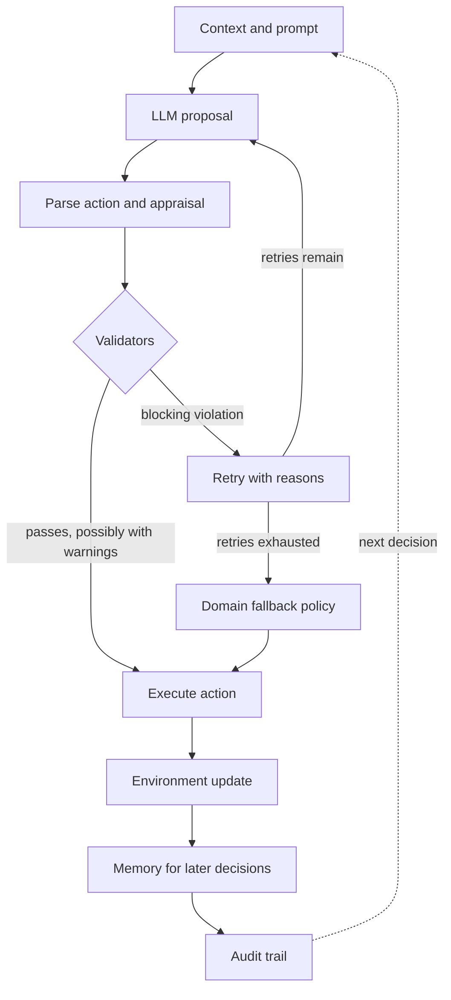

# WAGF: governed LLM agents for water simulations

[English](README.md) | [繁體中文](README_zh.md)

## What WAGF is

WAGF (Water Agent Governance Framework) is a governance layer between
language-model agents and a water or agent-based simulation.
An agent proposes an action. Before the simulation executes it, validators
check physical and institutional limits and compare the action with the
agent's stated appraisal. A blocking violation sends the agent back to decide
again, with a reason when rule feedback is enabled.

For example, an irrigation agent may request more water than the simulated
allocation allows. A flood agent may describe a high threat but choose an
action that conflicts with the study's behavioural theory.
WAGF makes these checks explicit in rules supplied by the researcher.

The simulation applies the resulting action and updates its state.
An audit trail records decisions, validation findings, and retry outcomes.
Optional attempt columns and a call journal provide more detail about retries.

## Why it exists

**Appraisal-action inconsistency.** An LLM agent can describe a situation one
way and act another way. It may report high water scarcity and still increase
its demand. Theory rules check whether the action agrees with the appraisal
the agent stated, under the behavioural theory chosen for the study.

**Actions outside the model's limits.** An agent can propose an action that
the water system or an institution does not permit, such as exceeding an
allocation or paying for an unaffordable measure. In a model with two-way
coupling, that action changes the shared resource and the conditions other
agents face. Feasibility rules check the proposal before it affects the world.

## How it works

One decision follows this path. The retry branch shown here uses full feedback.



The diagram shows the decision sequence; a run also records rejections and
parse failures. In a multi-agent run, the environment can apply the combined
actions at the end of a period.

### Governance rules and modes

Researchers define rules for their domain. Feasibility rules read model state,
such as available water or household funds; theory rules read the agent's
appraisal labels. Either kind can be configured as a blocking error or a warning.

| Setting | What it does |
|---|---|
| `level: ERROR` | Blocks the proposal and starts a retry, up to `max_retries`. |
| `level: WARNING` | Records a finding without blocking execution. |
| `strict` | Applies the domain's configured governance rules. |
| `disabled` | Uses the domain's comparison profile; the checks retained depend on that domain. |
| `retry_feedback_mode: full` | Returns the rejection reason in the retry prompt. |
| `retry_feedback_mode: silent` | Reuses the original prompt without the rejection reason; validation still runs. |

A profile named `disabled` does not guarantee that all feasibility checks are
removed. For example, irrigation v3 retains its identity rules in this profile.
Domains can declare further profiles (irrigation v3 also has `feasibility_only`).

When retries run out, `on_retry_exhausted: default` executes the registry's
default action. The opt-in `keep_proposal` policy can retain a registered
rejected proposal, but the broker runs the default action instead when any
blocker is marked as a hard constraint, and refuses the setting outright when
coupling is enabled. Domain authors must classify these constraints correctly.

Warnings reach the agent only if a separate advice channel is enabled.
See the [governance guide](docs/guides/governance_layers.md) for rule levels,
feedback settings, and their interpretation.

### Memory

Memory stores experiences for later prompts, with options for a recent window
or selective retrieval and reflection. Researchers choose the engine and its
settings for the domain in the [memory guide](docs/modules/memory_components.md).

### DomainPack

A `DomainPack` supplies domain hooks and registrations, alongside action
definitions, prompts, governance rules, and the chosen behavioural framework.
It lets a new domain use the broker without adding domain logic to its core;
see the [DomainPack guide](docs/guides/domain_pack_guide.md).

### Coupling to an external model

A connector exchanges observations and actions with a model; a
`CouplingContract` declares units, ranges, types, direction, and cadence.
The [coupling guide](docs/COUPLING_CONNECTORS.md) covers in-process solvers,
file replay patterns, subprocess models, and exchange with another ABM.

Runtime adapter checks cover declared values, but they do not verify unit
conversion. The irrigation example implements its water balance inside the
domain rather than through this generic contract adapter.

### Audit and reproducibility

Runs write traces and metadata so researchers can inspect what was proposed,
which rules fired, and what happened after a retry. The default decision trace
does not retain every retry's complete prompt and response.

| Record | Purpose |
|---|---|
| Raw JSONL traces and governance audit CSVs | Decision records with validation findings and retry outcomes. |
| `reproducibility_manifest.json` | Code revision, model information, seeds, and configuration provenance. |
| `config_snapshot.yaml` | Agent-type configuration used for the run (rules and settings, with command-line overrides). Prompt template files are referenced by path, not copied. |
| `run_integrity.json` | Audit coverage and integrity checks, including coupling provenance. |
| Optional attempt columns | Attempt actions, labels, and blocking rules when enabled. |
| Optional LLM call journal | Recorded calls for replay of completed steps after a crash. |

The builder supports `with_llm_journal(...)` and `with_resume_journal(...)`.
Resume rebuilds state by replaying recorded responses; a call with no matching
record raises an error instead of calling the model live. A recorded seed alone
does not guarantee identical live LLM responses.

The audit comparison tool checks normalized content for byte identity after
removing timestamp and timing differences and sorting set representations.
The recovery tool rebuilds audit CSVs from JSONL traces. Inspect their usage with:

```bash
python -m broker.tools.compare_audit_csv --help
python -m broker.tools.recover_csv_from_jsonl --help
```

Read the [audit schema](docs/AUDIT_SCHEMA.md) before analysing a run, especially
its column limitations and distinctions between proposed and executed actions.

## How to use it

### Install

Use Python 3.10 or later (`pyproject.toml` requires `>=3.10`):

```bash
git clone https://github.com/WenyuChiou/WAGF.git
cd WAGF
python -m pip install -e .
```

The core installation is enough for the mock runs below.
They use scripted responses and require no model download or API key.

### Run the smoke test

From the repository root:

```bash
python examples/quickstart/02_governance.py
```

This script uses the mock model. It first allows a protective action, then
blocks repeating it after the agent is already protected and retries the
decision. It writes audit files and traces under
`examples/quickstart/results/` (created by the run).

See the [quickstart tutorial](examples/quickstart/README.md) for the companion
barebone example and a description of the pipeline.

### Run a coupled example

The catastrophe example shows an insurer's claim decision coupled to a hazard
and loss model, with a solvency check before payment:

```bash
python examples/cat_model/run_cat.py --model mock --years 3
```

Outputs go to `examples/cat_model/results/` (created by the run).
A mock run checks the wiring; it does not validate a behavioural theory or
establish that the physical model represents a real basin.

### Run with a real model

With local Ollama installed and running, download the model and run the flood
example:

```bash
ollama pull gemma3:4b
python examples/single_agent/run_flood.py --model gemma3:4b --years 3 --agents 10
```

For cloud models, use `--model anthropic:<id>`, `--model openai:<id>`, or
`--model gemini:<id>`; the providers read `ANTHROPIC_API_KEY`, `OPENAI_API_KEY`,
or `GOOGLE_API_KEY`, respectively, from the environment.
See the [troubleshooting guide](docs/guides/troubleshooting_guide.md) for setup
and connection problems.

### Run the tests

CI uses this command to exclude tests named `real_llm`:

```bash
python -m pytest tests/ broker/ -ra --tb=short --continue-on-collection-errors -k "not real_llm"
```

### Build your own domain

Start with an action skeleton, then add the model state, prompts, rule basis,
and execution logic for your research question:

```bash
python -m broker.tools.scaffold_domain my_domain --framework generic --skills "action_a,action_b"
python -m broker.tools.validate_prompt examples/my_domain_demo/config/agent_types.yaml
python examples/my_domain_demo/run_experiment.py --model mock --years 1 --agents 1
```

The first command creates `examples/my_domain_demo/`; the next two use files
it generates. `generic` starts without selecting a named behavioural theory.
The skeleton's mock response can trigger missing-field warnings and fallback;
a completed run with audit output checks that its pipeline is connected.
Replace the placeholder actions and connect the domain hooks to your simulation
before treating the skeleton as a research model.

The generator is [broker/tools/scaffold_domain.py](broker/tools/scaffold_domain.py).
Follow the [new-domain guide](docs/guides/HOW_TO_ADD_A_NEW_DOMAIN.md) for the
configuration and Python hooks needed beyond the skeleton.

Claude Code users can use the bundled [WAGF skills](docs/skills/wagf-skills.md)
in [.claude/skills/](.claude/skills/). Start with `wagf-domain-builder`,
use `wagf-coupling-designer` for an external model, and check the result with
`wagf-verification-ladder`. The
[AI-assisted setup guide](docs/AI_ASSISTED_SETUP.md) explains this workflow.

## Examples

The two main water cases are marked below. The other runnable examples are
demonstrations of individual parts of the framework; the fixture is test-only.

| Example | What it shows |
|---|---|
| **Main water case: [single-agent flood](examples/single_agent/)** | Adapted from Yang and Chiou (2026, WRR): one-way coupling from flood conditions to household decisions, with appraisal-action coherence under Protection Motivation Theory (PMT). |
| **Main water case: [irrigation v3](examples/irrigation_abm/)** | Re-implements the irrigation decision setup of Hung and Yang (2021, WRR) with 78 water users and a simplified CRSS-style Colorado River model: two-way feedback through Lake Mead and feasibility checks. |
| [Quickstart](examples/quickstart/) | Scripted mock decisions that introduce execution, memory, and governance. |
| [Governed flood](examples/governed_flood/) | A compact flood teaching example with domain rules. |
| [Multi-agent flood](examples/multi_agent/flood/) | Households, government, and an insurer sharing a flood environment in a declared phase order. |
| [Catastrophe model](examples/cat_model/) | Hazard-to-loss coupling and governed insurer payouts, including a shared-pool variant. |
| [Reservoir control](examples/reservoir_control/) | A governed numeric release setpoint passed to a toy reservoir solver. |
| [Reservoir control with multiple setpoints](examples/reservoir_control_multidim/) | Joint release, hydropower, and flood-pool proposals checked before execution. |
| [Coupling examples](examples/coupling_examples/) | A subprocess connector exchanging JSON with an external toy model. |
| [Vaccination](examples/vaccination_demo/) | A non-water domain registering the Health Belief Model (HBM). |
| [Test fixtures](examples/_test_fixtures/) | A non-water traffic DomainPack used by integration tests, without a standalone runner. |

The irrigation model is a simplified surrogate, not the full CRSS model.
Consult its [README](examples/irrigation_abm/README.md) for assumptions and data
requirements. The [examples index](examples/README.md) describes the remaining
directories and entry points.

## Where to go next

| You want to | Read |
|---|---|
| Find files and entry points | [Repository map](docs/REPO_MAP.md) |
| Understand the runtime | [Architecture overview](ARCHITECTURE.md) and [runtime architecture](docs/architecture/architecture.md) |
| Choose rules and feedback settings | [Governance guide](docs/guides/governance_layers.md) |
| Design an experiment | [Experiment design guide](docs/guides/experiment_design_guide.md) |
| Add a domain | [New-domain guide](docs/guides/HOW_TO_ADD_A_NEW_DOMAIN.md) and [DomainPack guide](docs/guides/domain_pack_guide.md) |
| Connect a simulator | [Coupling guide](docs/COUPLING_CONNECTORS.md) |
| Analyse a run | [Reproduction and analysis guide](reproduction/README.md) |
| Interpret traces | [Audit schema](docs/AUDIT_SCHEMA.md) |
| Diagnose a setup problem | [Troubleshooting guide](docs/guides/troubleshooting_guide.md) |
| Check framework constraints | [Broker invariants](broker/INVARIANTS.md) |

For known limitations, read the [audit schema](docs/AUDIT_SCHEMA.md) and
[broker invariants](broker/INVARIANTS.md).

### How to cite

The framework paper is in preparation. Cite Yang and Chiou (2026) and this
repository until it appears.

```bibtex
@article{yang2026wrr,
  author  = {Yang, Y. C. Ethan and Chiou, Wenyu},
  title   = {Leveraging Large Language Models for Agent-Based Simulation of Human-Water System Interactions},
  journal = {Water Resources Research},
  year    = {2026},
  volume  = {62},
  number  = {6},
  pages   = {e2025WR042111},
  doi     = {10.1029/2025WR042111}
}

@misc{wagf,
  author = {Chiou, Wenyu and Yang, Y. C. Ethan},
  title  = {{WAGF}: a governance layer for language-model agents in coupled
            human-water models},
  year   = {2026},
  note   = {Framework paper in preparation}
}
```

The irrigation testbed follows the CRSS setup of Hung, C.-L. J., & Yang,
Y. C. E. (2021), *Water Resources Research* 57(7), e2020WR029262.

### Licence

MIT. See [LICENSE](LICENSE).
