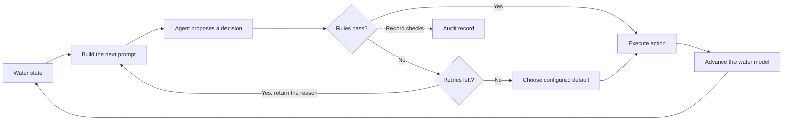

# Water Agent Governance Framework (WAGF)

**Check the water decisions of language-model agents before they change your simulation.**

[](https://github.com/WenyuChiou/WAGF/actions/workflows/test.yml)
[](.github/workflows/test.yml)
[](LICENSE)

WAGF connects agents, rules and water models for agent-based studies of irrigation
and flood adaptation. You supply the water model and the rules;
WAGF checks proposals, gives reasons for retries and records what happened.



[Tutorial](docs/tutorial/README.md) · [Examples](examples/README.md) ·
[Architecture](ARCHITECTURE.md) · [Reference](docs/guides/readme_reference.md)

[中文](README_zh.md)

## Quickstart

Use **Python 3.10+** and the same Python for installation and runs.
Clone the repository, then run commands from its root:

```bash
git clone https://github.com/WenyuChiou/WAGF.git
cd WAGF
python -m pip install -e ".[analysis]"
```

On macOS/Linux, use `python3` if `python` is unavailable; use that interpreter
throughout. The [setup check](docs/guides/readme_reference.md#check-your-python-setup)
confirms the imports and prints `WAGF imports OK`.

Run the two water cases with the repository's built-in **mock model**. No model
download, GPU or API key is needed. Choose fresh output directories for each run.

**Flood: one year, two households.**

```bash
python examples/single_agent/run_flood.py --model mock --years 1 --agents 2 --workers 1 --seed 42 --governance-mode strict --output .tmp/readme-flood
```

Selected output on Windows (the absolute output path shortened to the chosen directory):

```text
 [Governance:Initial] Agent_1 | Choice: 'buy_insurance' | Validation FAILED | Errors: ['Response missing required fields: threat_appraisal, coping_appraisal']
[Governance:Retry] Attempt 1 failed validation for Agent_1. Errors: ['Response missing required fields: threat_appraisal, coping_appraisal']
  - Action: Executing 'do_nothing' (policy=default, Result: REJECTED)
[Audit] Finalized. Summary: .tmp\readme-flood\audit_summary.json
```

Read `household_governance_audit.csv` in that directory for the proposal, rejected
attempts and executed default. The mock omits appraisals and never repairs its
answer; this demonstrates retries ending in a default. It also produces no stored
reflections, so the runner prints an integrity warning. It is a wiring check,
not a reflection-on experiment.

**Irrigation: two years, two water users, coupled to Lake Mead.**

```bash
python examples/irrigation_abm/run_experiment.py --model mock --years 2 --agents 2 --workers 1 --seed 42 --governance-mode strict --coupling --output .tmp/readme-irrigation
```

Selected output on Windows:

```text
 [Governance:Initial] Agent_000 | Choice: 'maintain_demand' | Validation FAILED | Errors: ['Response missing required fields: water_scarcity_assessment, adaptive_capacity_assessment']
[Governance:Retry] Attempt 1 failed validation for Agent_000. Errors: ['Response missing required fields: water_scarcity_assessment, adaptive_capacity_assessment']
  - Action: Executing 'maintain_demand' (policy=default, Result: REJECTED)
[Year 1] maintain_demand: 2 (drought=0.22)
[Year 2] maintain_demand: 2 (drought=0.25)
[Audit] Finalized. Summary: .tmp\readme-irrigation\audit_summary.json
--- Complete! Results in .tmp\readme-irrigation ---
```

Read `irrigation_farmer_governance_audit.csv` and `simulation_log.csv` there.
The mock again omits appraisals and uses defaults, with no stored reflections.
Lake Mead's level changes between years, while the shortage tier stays at 0 in
this tiny run. [Tutorial chapter 4](docs/tutorial/04-water-model.md) uses the
existing 78-user data with the mock to show a tier transition and the tier cut it causes.

The mock model above is a wiring check: it never states an appraisal, so its
answers fail the format check and every decision ends in the default. With a real
model the rules themselves do the work. This excerpt is copied from the audit
record of a real governed irrigation run (gemma3:4b through Ollama; one water user's
year-2 decision from a 15-year, 78-user run); it illustrates the loop and is not a result:

```text
MohaveValleyIDD, year 2
Attempt 1  water scarcity: H (scarce)   decision: increase_demand
  Blocked: "Demand increase blocked under the rule on increases under scarcity:
  at the start of this decision you judged water to be scarce this year, and a
  larger request when water is scarce draws more from a supply you share with
  other users."
Attempt 2  water scarcity: H (scarce)   decision: maintain_demand   -> approved
  Reasoning: "Given the Tier 1 shortage and declining Lake Mead levels, a cautious
  approach is warranted. [...] I will prioritize maintaining my established water
  use given the scarcity."
```

For a real local run, start Ollama with a downloaded model, then replace
`--model mock` with `--model gemma4:12b` (flood) or `--model gemma3:4b`
(irrigation), the models this project's own runs use, and choose new output
directories. Install the model packages with `python -m pip install -e ".[llm,analysis]"`;
see [local and cloud models](docs/guides/readme_reference.md#local-and-cloud-models).

Continue with the [six short tutorial chapters](docs/tutorial/README.md): flood,
blocking and retries, audit records, two-way irrigation coupling, journal recovery,
and irrational behaviour rate (IBR) and effective heterogeneity entropy (EHE)
with the existing analysis modules. These measure counted rule violations and
how evenly decisions spread across the available actions.

## Why WAGF?

A language-model agent can describe severe water scarcity and then ask for more
water. It can propose a withdrawal beyond its water right, or an action the
reservoir cannot supply. A simulation also needs a record of those proposals,
including the ones it blocked.

WAGF puts explicit checks between the proposal and its execution. Rules can
compare an action with the agent's own appraisal, physical limits and
institutional requirements. Rejected proposals return to the agent with the
reason. You define those rules and the default action; checking them does not
validate the assumptions of your study.

## Features

- **Rules and retry feedback.** Configure blocking rules or warnings, and compare
  rule sets. [Governance guide](docs/guides/governance_layers.md)
- **Water-model coupling.** Exchange storage, deliveries and shortages with your
  model, with declared units, ranges and timing.
  [Coupling guide](docs/COUPLING_CONNECTORS.md)
- **Audit records.** Inspect proposed and final actions, rejected attempts and
  retry reasons; enable attempt columns when you need them.
  [Audit schema](docs/AUDIT_SCHEMA.md)
- **Memory and reflection.** Carry earlier shortages or flood experience into
  later prompts. [Memory](docs/modules/memory_components.md) ·
  [Reflection](docs/modules/reflection_engine.md)
- **Recovery and provenance.** The irrigation runner journals model calls for replay after interruption;
  retain configuration, seed and run-integrity records.
  [Recovery tutorial](docs/tutorial/05-resume.md)

Defaults and retry limits are part of the model design. A configured default
executes without another validator pass; see the
[rule and coupling constraints](docs/guides/readme_reference.md#core-concepts).

## Examples

Two examples, two coupling directions:

| Water example | What flows which way | Command and case guide |
|---|---|---|
| Flood adaptation — one-way | The flood hazard drives household decisions; households do not change the hazard. | [Mock command above](#quickstart) · [Flood README](examples/single_agent/README.md) |
| Colorado River irrigation — two-way | Users' requests change Lake Mead; its level and shortage tier change deliveries and the information in later prompts. | [Mock command above](#quickstart) · [Irrigation README](examples/irrigation_abm/README.md) |

[The examples gallery](examples/README.md) records measured mock runtimes, outputs
and limitations. These small checks do not establish scientific results.

## Documentation

| Start with a question | Read |
|---|---|
| How do I run, add rules, audit, couple and resume? | [Tutorial](docs/tutorial/README.md) |
| How do the parts fit together? | [Architecture](ARCHITECTURE.md), [repository map](docs/REPO_MAP.md) |
| How do I configure my water agents? | [Configuration reference](docs/references/yaml_configuration_reference.md), [DomainPack guide](docs/guides/domain_pack_guide.md) |
| How does the framework tell an agent why a proposal was returned and what it may do next? | [Retry feedback guide](docs/guides/retry_feedback_guide.md) |
| How do I connect a water model? | [Coupling guide](docs/COUPLING_CONNECTORS.md) |
| How do I design and check a study? | [Experiment design](docs/guides/experiment_design_guide.md), [calibration](docs/guides/calibration_guide.md) |
| How do I set up models and check reproducibility? | [Water modelling reference](docs/guides/readme_reference.md) |
| What if something fails? | [Troubleshooting](docs/guides/troubleshooting_guide.md), [broker invariants](broker/INVARIANTS.md) |

## How to cite

The package version is 0.6.0.

The WAGF methods paper is **in preparation**. Cite the software and record the
version and commit used in your study:

```bibtex
@software{wagf,
  author  = {Chiou, Wenyu and Yang, Y. C. Ethan},
  title   = {Water Agent Governance Framework (WAGF)},
  year    = {2026},
  version = {0.6.0},
  url     = {https://github.com/WenyuChiou/WAGF}
}
```

Related water-modelling publications are listed in the
[reference guide](docs/guides/readme_reference.md#related-publications).

## Contributing

Read [CONTRIBUTING.md](CONTRIBUTING.md) and the
[broker invariants](broker/INVARIANTS.md). For bug reports, include your command,
configuration and error output. See [testing and reproducibility](docs/guides/readme_reference.md#testing-and-reproducibility)
for development checks and [AI-assisted setup](docs/AI_ASSISTED_SETUP.md) for the
repository's coding-assistant guides.

## License

[MIT](LICENSE).
