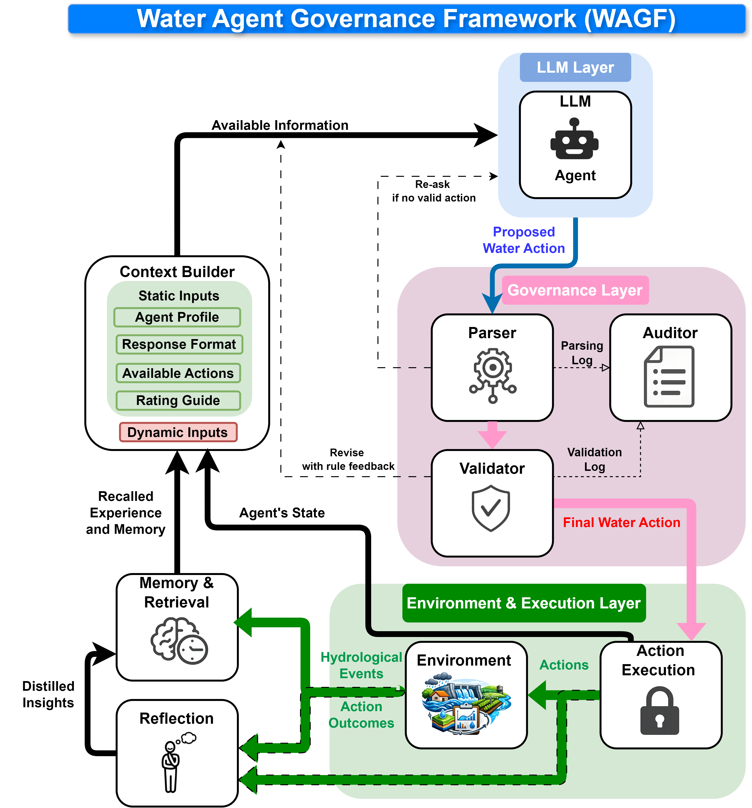

# Water Agent Governance Framework (WAGF)

A framework for checking language-model decisions before they enter a water simulation.

[](https://github.com/WenyuChiou/WAGF/actions/workflows/test.yml)
[](.github/workflows/test.yml)
[](LICENSE)

<p align="center"></p>

The Context Builder assembles a prompt, the information and instructions given to the language model (LLM). The Governance layer uses the Parser to read the model's proposed water action, a Validator (a rule checker) to check it, and the Auditor to record the checks. If no valid action is found the model is re-asked; if a rule rejects the action, it is asked to revise with rule feedback. The Environment and Execution layer applies the final action; Memory and Retrieval and optional Reflection carry experience into the next decision.

[English](README.md) | [繁體中文](README_zh.md)

## What WAGF is

An agent is a simulated water user or operator whose decisions come from a language model. WAGF checks each proposed decision against physical limits and institutional rules, such as available water or a water right, before it reaches the water model.

It also checks that the action fits what the agent said about its situation. For example, an agent that reports severe water scarcity and then increases its demand can be blocked, under the behavioural theory the study uses.

Researchers supply the rules and water model. WAGF connects them and records each decision. It is intended for socio-hydrology and agent-based modelling of coupled natural-human systems. The examples demonstrate the framework; their assumptions still need validation for a study.

## When should you use WAGF?

- You have a water model (river basin, reservoir or flood model) and want the human decisions in it, such as irrigation demand, flood protection or reservoir release, to come from language-model agents instead of fixed decision rules.
- You want each proposed decision checked against physical limits and institutional rules, such as water rights, available water or household funds, before it changes the model.
- You want to compare runs under different rule sets, for example all rules on against behavioural rules off, and see which proposals were rejected and why.
- You want shortages, deliveries or flood damage computed by the water model to feed back into the agents' later decisions.
- You want a record of each decision (the final action, the rules that fired and the number of retries), so that a run can be inspected afterwards.

## Feature highlights

- **Governance rules and profiles:** a governance profile is a named set of rules for a run, such as `strict`; each rule either blocks a proposal or only records a warning. See [governance](docs/guides/governance_layers.md).
- **Memory and reflection:** agents recall earlier events, such as last year's shortage, and can optionally write a short summary of what they learned. See [memory](docs/modules/memory_components.md) and [reflection](docs/modules/reflection_engine.md).
- **DomainPack:** a domain is WAGF's word for one application (its agents, actions, rules and prompt), not the model's spatial extent. A DomainPack is the settings and Python functions that describe it to WAGF. See [DomainPack](docs/guides/domain_pack_guide.md).
- **External-model coupling:** pass model results, such as storage or shortage, to the agents and their actions back to your model, declaring the unit and allowed range of each value. See [coupling](docs/COUPLING_CONNECTORS.md).
- **Audit and reproducibility:** audit traces record each decision, the rules that fired and the retries; optional columns add every attempt; a manifest records code, model, seed and configuration. See the [audit schema](docs/AUDIT_SCHEMA.md) and [run-integrity contract](broker/INVARIANTS.md#invariant-6--run-integrity-provenance-contract).

## Getting started

Steps 1–4 need Python and a laptop, with no GPU, no language-model download and no API key. Run commands from the repository root.

### 1. Install

Use Python 3.10 or later; the automated tests run on Python 3.10, 3.11 and 3.12. On macOS or Linux use `python3`, or create a virtual environment first.

```bash
git clone https://github.com/WenyuChiou/WAGF.git
cd WAGF
python -m pip install -e .
```

If you already downloaded the repository, enter that folder and run only the install command. pip should end with `Successfully installed ... water-agent-governance-framework-<version>`.

If it fails: check [required packages](pyproject.toml). Use the same Python for installation and subsequent steps.

### 2. Check your environment

Confirm that Python can load WAGF and its required packages; expect `WAGF imports OK`:

```bash
python -c "import broker, numpy, pandas, pydantic, requests, yaml; print('WAGF imports OK')"
```

If it fails: for missing modules, repeat step 1 with this Python; see [required packages](pyproject.toml).

### 3. Run the mock smoke test

A mock model supplies scripted decisions instead of calling a language model. This short test checks that a decision passes through every stage of WAGF on your computer:

```bash
python examples/quickstart/02_governance.py
```

- Expect `take_action (APPROVED)` in year 1 and `do_nothing (APPROVED) [retried 1x]` in years 2–4.
- The rule stops the agent from taking protection it already has. Lines saying `Validation FAILED ... already_protected` are this rule at work.
- Files appear in `examples/quickstart/results/`, including an audit CSV and `raw/simple_agent_traces.jsonl`.
- A message starting `[AuditInvariant]` is expected: this small example leaves some optional columns at default values.

If it fails: move any finished `examples/quickstart/results/` run aside first; for other errors, see the [tutorial](examples/quickstart/README.md) and [troubleshooting guide](docs/guides/troubleshooting_guide.md).

### 4. Read the output

Print the main decision columns; expect four rows, one per simulated year:

```bash
python -c "import pandas as pd; print(pd.read_csv('examples/quickstart/results/simple_agent_governance_audit.csv')[['year','agent_id','final_skill','status','retry_count']].to_string(index=False))"
```

| Column | Meaning in this example |
|---|---|
| `year`, `agent_id` | Decision year and the simulated decision-maker. |
| `final_skill` | Final selected action: take protection or do nothing. |
| `status` | Whether the final decision was approved. |
| `retry_count` | Extra attempts after a rule blocked a proposal: 0, then 1 in each later year. |

`raw/simple_agent_traces.jsonl` holds the full record of each decision, one per line. These checks confirm the connection works; they do not calibrate or validate a water model.

If it fails: check that step 3 finished; see the [audit schema](docs/AUDIT_SCHEMA.md) for column limitations.

### 5. Run a water example with a local model

Install the optional model and analysis packages. Install and start Ollama, a free program that runs language models on your own computer (https://ollama.com), then download a model:

```bash
python -m pip install -e ".[llm,analysis]"
ollama pull gemma3:4b
python examples/single_agent/run_flood.py --model gemma3:4b --years 3 --agents 10 --output results/flood_first_run
```

Expect yearly household decisions and `results/flood_first_run/simulation_log.csv`, `household_governance_audit.csv` and `raw/household_traces.jsonl`. Use a new output folder for each run. Speed and memory needs depend on your computer.

Thinking (extra reasoning output from models that support it) is off by default; add `--thinking-mode enabled` to request it. A few models cannot turn thinking off; WAGF notes this in the run manifest. See the [model configuration reference](docs/references/yaml_configuration_reference.md#214-global_configllm).

See the [flood manual](examples/single_agent/README.md) for inputs and outputs. Cloud models use `--model anthropic:<id>`, `openai:<id>` or `gemini:<id>`. Set `ANTHROPIC_API_KEY` for Anthropic, `OPENAI_API_KEY` for OpenAI or `GOOGLE_API_KEY` for Gemini. Cloud models also need the provider's own package: `python -m pip install anthropic`, `python -m pip install openai` or `python -m pip install google-generativeai`.

If it fails: see [Ollama troubleshooting](docs/guides/troubleshooting_guide.md#3-ollama-connection-issues); for a finished output folder, choose a new one.

### 6. Start your own domain or connect your water model

Generate a folder for your own decision model:

```bash
python -m broker.tools.scaffold_domain my_domain --framework generic --skills "action_a,action_b"
```

Expect `Scaffolded` and `examples/my_domain_demo/` with configuration, a prompt and a runner. `--skills` lists the actions an agent can choose; WAGF calls actions skills.

Replace the placeholder actions with your water decisions, then follow [Build your own domain](#build-your-own-domain) below. To connect an existing hydrological or water-system model, follow the [coupling guide](docs/COUPLING_CONNECTORS.md).

If it fails: for name errors, use lowercase letters and underscores; for an existing folder, choose another name.

## Core concepts

| Figure stage | What it does | Read more |
|---|---|---|
| Context Builder | Collects the agent's attributes, current water conditions, available actions and recalled experience. | [Context system](docs/modules/context_system.md) |
| LLM | Reads the prompt and proposes an action, with its assessment of the situation, such as how severe the shortage is. | [Configuration](docs/references/yaml_configuration_reference.md) |
| Governance: Parser | Reads the response into the action fields required by the domain. | [Governance core](docs/modules/governance_core.md) |
| Governance: Validator | Checks that the action is feasible and fits the assessment; if a blocking rule fails, the model is asked again. | [Governance guide](docs/guides/governance_layers.md) |
| Governance: Auditor | Records parsing, validation and retry outcomes. | [Audit schema](docs/AUDIT_SCHEMA.md) |
| Environment and Execution | Applies the final action and updates water conditions and agent state. | [Simulation engine](docs/modules/simulation_engine.md) |
| Memory and Retrieval | Stores experience and selects it for later prompts. | [Memory guide](docs/modules/memory_components.md) |
| Reflection | Optionally summarises past experience into lessons. | [Reflection guide](docs/modules/reflection_engine.md) |

See [ARCHITECTURE.md](ARCHITECTURE.md) for the design and [broker/INVARIANTS.md](broker/INVARIANTS.md) for required behaviour.

- The `strict` profile applies the domain's configured rules. A profile named `disabled` can still retain checks; irrigation keeps its water-right, minimum-use and beneficial-use limits (its `identity_rules`) under `disabled`.
- ERROR findings block a proposal; WARNING findings do not. A rejected proposal is retried up to the configured limit; see [configuration](docs/references/yaml_configuration_reference.md) for retry feedback.
- When retries run out, the domain's default action runs without a further check. The opt-in `keep_proposal` setting runs the rejected proposal itself instead, unless a rule that blocked it is marked as a hard limit, in which case the default action runs. The setting is refused when a coupled model is enabled; see [invariants](broker/INVARIANTS.md).
- A `CouplingContract` lists each value exchanged with your model, with its unit, allowed range and timing. WAGF checks values against the declared range; it does not convert units or check a conversion.
- The irrigation example implements its water balance within its domain. Its model is a simplified stand-in for CRSS, the Bureau of Reclamation's Colorado River Simulation System, not CRSS itself.

## Examples

The [examples index](examples/README.md) covers inputs and setup. Run commands from the repository root.

| Domain | What it shows | Path | How to run |
|---|---|---|---|
| Quickstart | Scripted execution, memory and rule checks. | [quickstart](examples/quickstart/) | Step 3 above. |
| Household flood | Flood conditions inform protection decisions. | [single_agent](examples/single_agent/) | Step 5 above. |
| Irrigation | Water demand, water rights, delivery and shortage feed back through a basin model. | [irrigation_abm](examples/irrigation_abm/README.md#1-quick-start) | `python examples/irrigation_abm/run_experiment.py --model gemma3:4b --years 5 --agents 5` (needs step 5's Ollama setup). |
| Governed flood | Compact teaching example with domain rules. | [governed_flood](examples/governed_flood/README.md) | Not runnable from a fresh clone: its input files `data/agent_initial_profiles.csv` and `config/flood_years.csv` are not in the repository. Use step 5 for a flood run. |
| Multi-agent flood | Households, government and an insurer share a flood environment. | [multi_agent/flood](examples/multi_agent/flood/) | [Run instructions](examples/multi_agent/flood/README.md). |
| Catastrophe model | Hazard and loss estimates inform governed insurer payments. | [cat_model](examples/cat_model/) | `python examples/cat_model/run_cat.py --model mock --years 3` |
| Reservoir control | A numeric release proposal reaches a toy reservoir solver. | [reservoir_control](examples/reservoir_control/) | `python examples/reservoir_control/run_reservoir_ops.py --model mock --years 4` |
| Reservoir with multiple setpoints | Release, hydropower and flood-pool proposals. | [reservoir_control_multidim](examples/reservoir_control_multidim/) | `python examples/reservoir_control_multidim/run_reservoir_multidim.py --model mock --years 4` |
| External process | Runs a separate toy model as its own program and exchanges values with it as JSON. | [coupling_examples](examples/coupling_examples/) | `python examples/coupling_examples/archetype_c_subprocess/run_archetype_c.py --model mock --years 4` |
| Vaccination | A non-water DomainPack using the Health Belief Model. | [vaccination_demo](examples/vaccination_demo/) | [Run instructions](examples/vaccination_demo/README.md). |
| Traffic test case | Checks that the framework accepts a non-water domain. | [_test_fixtures](examples/_test_fixtures/) | Integration tests; no standalone runner. |

To rerun an example, add `--output <new folder>`. The quickstart script in step 3 has no `--output` option: move `examples/quickstart/results/` aside first. The traffic test case runs through the [tests below](#testing-and-reproducibility), rather than a standalone command.

## Build your own domain

After step 6, check the prompt and run the generated model with scripted responses:

```bash
python -m broker.tools.validate_prompt examples/my_domain_demo/config/agent_types.yaml
python examples/my_domain_demo/run_experiment.py --model mock --years 1 --agents 1
```

The first command reports configuration errors and warnings. The second writes audit output under `examples/my_domain_demo/results/smoke/`. The generated example is incomplete on purpose, so the run prints `Validation FAILED` and `Max retries (3) reached`. It worked if it ends with `Done. Audit + traces under: ...`.

To run it again, add `--output results/smoke2` (relative to `examples/my_domain_demo/`) or delete `results/smoke/` first; WAGF refuses to overwrite a finished run.

Use the [new-domain guide](docs/guides/HOW_TO_ADD_A_NEW_DOMAIN.md) to supply model state, prompts, rules and action execution. Follow the [verification ladder](.claude/skills/wagf-verification-ladder/SKILL.md): environment, configuration, mock run, domain tests, real-model pilot, then acceptance before a larger study.

If you use an AI coding assistant such as Claude Code, the repository includes step-by-step guides for it, called skills; see [WAGF skills](docs/skills/wagf-skills.md) and [AI-assisted setup](docs/AI_ASSISTED_SETUP.md).

## Documentation

| You want to | Read |
|---|---|
| Understand the design and find files | [Architecture](ARCHITECTURE.md), [runtime architecture](docs/architecture/architecture.md), [repository map](docs/REPO_MAP.md) |
| Check framework constraints | [Broker invariants](broker/INVARIANTS.md) |
| Configure rules, prompts and model settings | [Configuration reference](docs/references/yaml_configuration_reference.md), [governance guide](docs/guides/governance_layers.md) |
| Design and validate a study | [Experiment design](docs/guides/experiment_design_guide.md), [calibration guide](docs/guides/calibration_guide.md) |
| Connect a model or add a domain | [Coupling](docs/COUPLING_CONNECTORS.md), [DomainPack](docs/guides/domain_pack_guide.md) |
| Use an AI coding assistant such as Claude Code with step-by-step guides, called skills | [Skills index](docs/skills/wagf-skills.md), [AI-assisted setup](docs/AI_ASSISTED_SETUP.md) |
| Analyse or recover a run | [Audit schema](docs/AUDIT_SCHEMA.md), [reproduction guide](reproduction/README.md), [irrigation replay runbook](examples/irrigation_abm/README.md#resuming-a-crashed-run) |
| Resolve errors or check changes | [Troubleshooting](docs/guides/troubleshooting_guide.md), [CHANGELOG](CHANGELOG.md) |

## Testing and reproducibility

Install the test dependencies and run the automated tests, excluding tests named `real_llm`. The automated tests also check the generated-domain workflow; see [.github/workflows/test.yml](.github/workflows/test.yml).

```bash
python -m pip install -r requirements.txt
python -m pip install -e ".[dev,web,analysis]"
python -m pytest tests/ broker/ examples/single_agent/tests -ra --tb=short --continue-on-collection-errors -k "not real_llm"
```

Runs write `reproducibility_manifest.json`, `config_snapshot.yaml` and `run_integrity.json` alongside the traces. Prompt files are referenced by path, not copied into the configuration snapshot; keep them with your run inputs. Record the code revision and retain the inputs: a seed alone does not make live language-model responses identical.

Optional columns record every attempt of a decision. WAGF can also save each model call to a file and replay it to resume a crashed run; see the [irrigation replay runbook](examples/irrigation_abm/README.md#resuming-a-crashed-run).

Default traces do not retain every retry's complete prompt and response. The [audit schema](docs/AUDIT_SCHEMA.md) explains placeholders and proposed versus executed actions.

The comparison tool ignores timestamps, run times and the order of unordered lists; the recovery tool rebuilds CSVs from JSONL. Inspect their usage:

```bash
python -m broker.tools.compare_audit_csv --help
python -m broker.tools.recover_csv_from_jsonl --help
```

## Related publications

The household flood example builds on Yang and Chiou (2026):

```bibtex
@article{yang2026wrr,
  author  = {Yang, Y. C. Ethan and Chiou, Wenyu},
  title   = {Leveraging Large Language Models for Agent-Based Simulation of Human-Water System Interactions},
  journal = {Water Resources Research},
  year    = {2026},
  volume  = {62},
  number  = {6},
  pages   = {e2025WR042111},
  doi     = {10.1029/2025WR042111}
}
```

The irrigation example re-implements the irrigation decision setup of Hung and Yang (2021):

Hung, F., & Yang, Y. C. E. (2021). Assessing adaptive irrigation impacts on water scarcity in nonstationary environments — A multi-agent reinforcement learning approach. *Water Resources Research*, 57, e2020WR029262. <https://doi.org/10.1029/2020WR029262>

## How to cite

Cite this repository and record the version and commit used in your study. The package version is 0.6.0.

```bibtex
@software{wagf,
  author  = {Chiou, Wenyu and Yang, Y. C. Ethan},
  title   = {Water Agent Governance Framework (WAGF)},
  year    = {2026},
  version = {0.6.0},
  url     = {https://github.com/WenyuChiou/WAGF}
}
```

## Contributing

For changes to code or documentation, read [CONTRIBUTING.md](CONTRIBUTING.md) and the [broker invariants](broker/INVARIANTS.md). [AGENTS.md](AGENTS.md) holds the instructions for AI coding assistants.
Use the tests above to check changes; report bugs with the command, configuration and error output needed to reproduce them.

## Licence

MIT. See [LICENSE](LICENSE).
