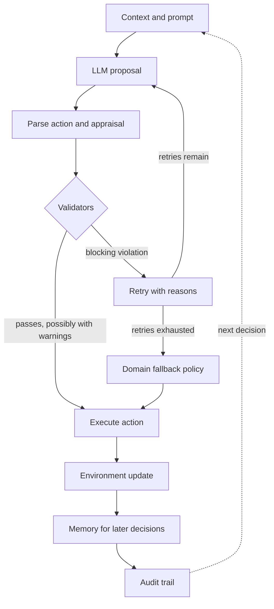

# WAGF：用於水資源模擬的受治理 LLM agent

[English](README.md) | [繁體中文](README_zh.md)

> 註：英文版 README 已於 2026 年 10 月改版，這份中文版尚未同步；兩者有出入時，以英文版為準。

## WAGF 是什麼

WAGF（Water Agent Governance Framework）是位於語言模型 agent 與水資源模擬或 agent-based simulation 之間的治理層。agent 提出行動後，validator 會在模擬執行前檢查物理與制度限制，並比較行動是否符合 agent 自己陳述的評估。若發現具阻擋效果的違規，系統會要求 agent 重新決策。啟用規則回饋時，也會說明原因。

例如，灌溉 agent 可能要求超過模擬分配量的用水。洪水 agent 也可能描述高度威脅，卻選擇與研究所採行行為理論不符的行動。WAGF 將這些檢查明確寫成研究者提供的規則。

模擬會套用最後得到的行動並更新狀態。audit trail 會記錄決策、驗證結果與重試結果。選用的嘗試欄位與呼叫日誌可提供更多重試細節。

## 為什麼需要 WAGF

**評估與行動不一致。** LLM agent 可能以一種方式描述情境，卻採取另一種方式的行動。它可能回報嚴重缺水，卻仍提高需求。理論規則會依據研究所選的行為理論，檢查行動是否符合 agent 自己陳述的評估。

**行動超出模型限制。** agent 可能提出水資源系統或制度不允許的行動，例如超出分配量取水，或支付負擔不起的措施費用。在雙向耦合模型中，這類行動會改變共享資源，以及其他 agent 面對的條件。可行性規則會在提案影響系統前進行檢查。

## 運作方式

單次決策會依照以下路徑進行。圖中的重試分支採用完整回饋。



此圖呈現決策順序，一次執行也會記錄拒絕與解析失敗。在多 agent 執行中，環境可在一個週期結束時套用所有合併後的行動。

### 治理規則與模式

研究者為自己的領域定義規則。可行性規則會讀取模型狀態，例如可用水量或家庭資金。理論規則則會讀取 agent 的評估標籤。兩類規則都能設定成會阻擋提案的錯誤，或不會阻擋執行的警告。

| 設定 | 功能 |
|---|---|
| `level: ERROR` | 阻擋提案並開始重試，最多重試 `max_retries` 次。 |
| `level: WARNING` | 記錄一項檢查發現，但不阻擋執行。 |
| `strict` | 套用領域所設定的治理規則。 |
| `disabled` | 使用領域的比較 profile，保留哪些檢查由該領域決定。 |
| `retry_feedback_mode: full` | 在重試 prompt 中回傳拒絕原因。 |
| `retry_feedback_mode: silent` | 重複使用原始 prompt，不附拒絕原因，驗證仍會執行。 |

名為 `disabled` 的 profile 不保證移除所有可行性檢查。例如，irrigation v3 會在此 profile 中保留身分規則。領域可以宣告其他 profile（irrigation v3 也有 `feasibility_only`）。

重試次數用盡時，`on_retry_exhausted: default` 會執行 registry 的預設行動。選用的 `keep_proposal` policy 可保留一項已註冊但遭拒的提案。然而，只要任一阻擋項被標記為硬性限制，broker 就會改為執行預設行動；啟用耦合時，broker 會直接拒絕這項設定。領域作者必須正確分類這些限制。

只有啟用獨立的建議 channel 時，agent 才會收到警告。規則層級、回饋設定及其解讀方式，請參閱[治理指南](docs/guides/governance_layers.md)。

### 記憶

記憶會儲存經驗供後續 prompt 使用，可選擇近期視窗或選擇性檢索與反思。研究者可依領域選擇引擎及其設定，詳見[記憶指南](docs/modules/memory_components.md)。

### DomainPack

`DomainPack` 會提供領域 hook 與註冊項目，以及行動定義、prompt、治理規則和選定的行為框架。它讓新領域可以使用 broker，而不必在 broker 核心加入領域邏輯，詳見 [DomainPack 指南](docs/guides/domain_pack_guide.md)。

### 與外部模型耦合

connector 會與模型交換觀測資料和行動，`CouplingContract` 則宣告單位、範圍、型別、方向及頻率。[耦合指南](docs/COUPLING_CONNECTORS.md)涵蓋同一程序內的 solver、檔案 replay 模式、subprocess 模型，以及與另一個 ABM 交換資料。

runtime adapter 會檢查宣告的值，但不會驗證單位轉換。灌溉範例是在領域內實作水量平衡，未使用這個通用 contract adapter。

### Audit 與可重現性

執行會寫入 trace 與 metadata，讓研究者檢查提出了什麼、觸發了哪些規則，以及重試後發生了什麼。預設的決策 trace 不會保留每次重試的完整 prompt 與 response。

| 記錄 | 用途 |
|---|---|
| 原始 JSONL trace 與治理 audit CSV | 包含驗證結果與重試結果的決策記錄。 |
| `reproducibility_manifest.json` | 程式碼 revision、模型資訊、seed 與 configuration provenance。 |
| `config_snapshot.yaml` | 執行時使用的 agent-type 設定（規則與設定值，含命令列覆寫）。Prompt template 檔案只以路徑引用，不會複製。 |
| `run_integrity.json` | Audit coverage 與 integrity 檢查，包括耦合 provenance。 |
| 選用的嘗試欄位 | 啟用時記錄每次嘗試的行動、標籤與阻擋規則。 |
| 選用的 LLM 呼叫日誌 | 記錄呼叫，以便當機後 replay 已完成的步驟。 |

builder 支援 `with_llm_journal(...)` 與 `with_resume_journal(...)`。resume 會 replay 已記錄的 response 以重建狀態；若某次呼叫沒有相符的記錄，系統會拋出錯誤，而不會即時呼叫模型。只記錄 seed 並不能保證即時 LLM response 完全相同。

audit 比較工具會移除 timestamp 與 timing 差異並排序 set representation，再檢查正規化內容是否具 byte identity。復原工具會從 JSONL trace 重建 audit CSV。可用以下命令查看用法：

```bash
python -m broker.tools.compare_audit_csv --help
python -m broker.tools.recover_csv_from_jsonl --help
```

分析一次執行前，請先閱讀 [audit schema](docs/AUDIT_SCHEMA.md)，並特別留意欄位限制，以及提議行動與實際執行行動之間的差異。

## 使用方式

### 安裝

請使用 Python 3.10 或更新版本（`pyproject.toml` 要求 `>=3.10`）：

```bash
git clone https://github.com/WenyuChiou/WAGF.git
cd WAGF
python -m pip install -e .
```

核心安裝已足以完成下方的 mock 執行。這些執行使用 scripted response，不需下載模型或提供 API key。

### 執行 smoke test

在 repository root 執行：

```bash
python examples/quickstart/02_governance.py
```

此 script 使用 mock model。它會先允許一項防護行動，接著在 agent 已受保護後阻擋重複採取該行動，並重試決策。它會在 `examples/quickstart/results/` 下寫入 audit 檔案與 trace，此目錄會在執行時建立。

請參閱[快速入門教學](examples/quickstart/README.md)，其中包含配套的 barebone 範例與 pipeline 說明。

### 執行耦合範例

catastrophe 範例展示保險公司的理賠決策如何與 hazard 和 loss model 耦合，並在付款前進行 solvency 檢查：

```bash
python examples/cat_model/run_cat.py --model mock --years 3
```

輸出會寫入 `examples/cat_model/results/`，此目錄會在執行時建立。mock 執行會檢查接線，但不會驗證行為理論，也不能證明物理模型代表真實流域。

### 使用真實模型執行

安裝並啟動本機 Ollama 後，下載模型並執行洪水範例：

```bash
ollama pull gemma3:4b
python examples/single_agent/run_flood.py --model gemma3:4b --years 3 --agents 10
```

雲端模型可使用 `--model anthropic:<id>`、`--model openai:<id>` 或 `--model gemini:<id>`；provider 會分別從環境讀取 `ANTHROPIC_API_KEY`、`OPENAI_API_KEY` 或 `GOOGLE_API_KEY`。設定與連線問題請參閱[疑難排解指南](docs/guides/troubleshooting_guide.md)。

### 執行測試

CI 使用以下命令排除名稱含有 `real_llm` 的測試：

```bash
python -m pytest tests/ broker/ -ra --tb=short --continue-on-collection-errors -k "not real_llm"
```

### 建立自己的領域

先建立 action skeleton，再加入研究問題所需的模型狀態、prompt、規則依據與執行邏輯：

```bash
python -m broker.tools.scaffold_domain my_domain --framework generic --skills "action_a,action_b"
python -m broker.tools.validate_prompt examples/my_domain_demo/config/agent_types.yaml
python examples/my_domain_demo/run_experiment.py --model mock --years 1 --agents 1
```

第一個命令會建立 `examples/my_domain_demo/`，後兩個命令則使用它產生的檔案。`generic` 不會在開始時選定具名的行為理論。skeleton 的 mock response 可能觸發缺少欄位警告與 fallback。完成一次產生 audit 輸出的執行，可確認 pipeline 已連接。在將 skeleton 視為研究模型前，請替換 placeholder action，並將領域 hook 連接到模擬。

generator 是 [broker/tools/scaffold_domain.py](broker/tools/scaffold_domain.py)。請依照[新領域指南](docs/guides/HOW_TO_ADD_A_NEW_DOMAIN.md)，完成 skeleton 之外所需的設定與 Python hook。

Claude Code 使用者可以使用內附的 [WAGF skills](docs/skills/wagf-skills.md)，這些 skill 位於 [.claude/skills/](.claude/skills/)。先使用 `wagf-domain-builder`，若要連接外部模型則使用 `wagf-coupling-designer`，再以 `wagf-verification-ladder` 檢查結果。[AI 輔助設定指南](docs/AI_ASSISTED_SETUP.md)會說明此工作流程。

## 範例

兩個主要水資源案例已在下方標示。其他可執行範例用來展示 framework 的個別部分，fixture 僅供測試使用。

| 範例 | 展示內容 |
|---|---|
| **主要水資源案例：[單 agent 洪水](examples/single_agent/)** | 改編自 Yang and Chiou（2026，WRR）：由洪水條件到家庭決策的單向耦合，以及保護動機理論（PMT）下的評估與行動一致性。 |
| **主要水資源案例：[irrigation v3](examples/irrigation_abm/)** | 重新實作 Hung and Yang（2021，WRR）的灌溉決策設定，包含 78 位用水者與簡化的 CRSS-style 科羅拉多河模型：透過 Lake Mead 的雙向回饋與可行性檢查。 |
| [快速入門](examples/quickstart/) | 以 scripted mock 決策介紹執行、記憶與治理。 |
| [受治理洪水](examples/governed_flood/) | 包含領域規則的精簡洪水教學範例。 |
| [多 agent 洪水](examples/multi_agent/flood/) | 家庭、政府與保險公司依宣告的階段順序共享洪水環境。 |
| [Catastrophe model](examples/cat_model/) | Hazard-to-loss 耦合與受治理的保險理賠，包括 shared-pool 變體。 |
| [水庫控制](examples/reservoir_control/) | 將受治理的數值放水 setpoint 傳給簡化的水庫 solver。 |
| [多 setpoint 水庫控制](examples/reservoir_control_multidim/) | 在執行前共同檢查放水、水力發電與防洪庫容提案。 |
| [耦合範例](examples/coupling_examples/) | 透過 subprocess connector 與外部簡化模型交換 JSON。 |
| [疫苗接種](examples/vaccination_demo/) | 註冊健康信念模型（HBM）的非水資源領域。 |
| [測試 fixture](examples/_test_fixtures/) | 整合測試使用的非水資源 traffic DomainPack，沒有獨立 runner。 |

灌溉模型是簡化的 surrogate，不是完整 CRSS 模型。其假設與資料需求請參閱該案例的 [README](examples/irrigation_abm/README.md)。[範例索引](examples/README.md)說明其餘目錄與進入點。

## 後續閱讀

| 目的 | 閱讀資料 |
|---|---|
| 尋找檔案與進入點 | [Repository map](docs/REPO_MAP.md) |
| 瞭解 runtime | [架構總覽](ARCHITECTURE.md)與 [runtime 架構](docs/architecture/architecture.md) |
| 選擇規則與回饋設定 | [治理指南](docs/guides/governance_layers.md) |
| 設計實驗 | [實驗設計指南](docs/guides/experiment_design_guide.md) |
| 新增領域 | [新領域指南](docs/guides/HOW_TO_ADD_A_NEW_DOMAIN.md)與 [DomainPack 指南](docs/guides/domain_pack_guide.md) |
| 連接 simulator | [耦合指南](docs/COUPLING_CONNECTORS.md) |
| 分析一次執行 | [重現與分析指南](reproduction/README.md) |
| 解讀 trace | [Audit schema](docs/AUDIT_SCHEMA.md) |
| 診斷設定問題 | [疑難排解指南](docs/guides/troubleshooting_guide.md) |
| 檢查 framework 限制 | [Broker invariants](broker/INVARIANTS.md) |

已知限制請參閱 [audit schema](docs/AUDIT_SCHEMA.md) 與 [broker invariants](broker/INVARIANTS.md)。

### 引用方式

引用時請註明本 repository 及所用的版本與 commit；若使用洪水案例，請一併引用 Yang and Chiou (2026)。

```bibtex
@article{yang2026wrr,
  author  = {Yang, Y. C. Ethan and Chiou, Wenyu},
  title   = {Leveraging Large Language Models for Agent-Based Simulation of Human-Water System Interactions},
  journal = {Water Resources Research},
  year    = {2026},
  volume  = {62},
  number  = {6},
  pages   = {e2025WR042111},
  doi     = {10.1029/2025WR042111}
}

@misc{wagf,
  author = {Chiou, Wenyu and Yang, Y. C. Ethan},
  title  = {{WAGF}: a governance layer for language-model agents in coupled
            human-water models},
  year   = {2026}
}
```

灌溉 testbed 採用 Hung, F., & Yang, Y. C. E.（2021），*Water Resources Research* 57，e2020WR029262 的 CRSS 設定。

### 授權條款

MIT。請參閱 [LICENSE](LICENSE)。
