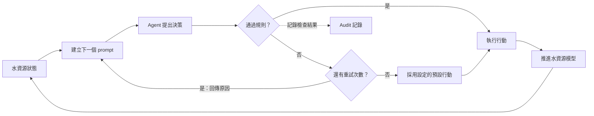

# Water Agent Governance Framework (WAGF)

**在語言模型 agent 的水資源決策改變你的模擬之前，先檢查這些決策。**

[](https://github.com/WenyuChiou/WAGF/actions/workflows/test.yml)
[](.github/workflows/test.yml)
[](LICENSE)



WAGF 把 agent、規則與水資源模型連接起來，用於灌溉與洪水調適的 agent-based 研究。水資源模型與規則由你提供；WAGF 負責檢查提案、在要求重試時說明原因，並記錄發生的過程。



[教學](docs/tutorial/README.md) · [範例](examples/README_zh.md) · [架構](ARCHITECTURE.md) · [參考資料](docs/guides/readme_reference.md)

[English](README.md) | 繁體中文：教學、架構、參考資料與各案例說明目前只有英文版。

## 快速開始

請使用 **Python 3.10+**，並以同一個 Python 安裝與執行。先 clone 本 repository，再從其根目錄執行命令：

```bash
git clone https://github.com/WenyuChiou/WAGF.git
cd WAGF
python -m pip install -e ".[analysis]"
```

在 macOS/Linux 上，若沒有 `python`，請改用 `python3`，並全程使用同一個直譯器。[安裝檢查](docs/guides/readme_reference.md#check-your-python-setup)會確認匯入正常，並印出 `WAGF imports OK`。

用 repository 內建的 **mock model** 執行兩個水資源案例，不需下載模型，也不需 GPU 或 API key。每次執行都請使用新的輸出目錄。

**洪水：一年、兩個家戶。**

```bash
python examples/single_agent/run_flood.py --model mock --years 1 --agents 2 --workers 1 --seed 42 --governance-mode strict --output .tmp/readme-flood
```

在 Windows 上的部分輸出（絕對輸出路徑已縮寫為所選目錄）：

```text
 [Governance:Initial] Agent_1 | Choice: 'buy_insurance' | Validation FAILED | Errors: ['Response missing required fields: threat_appraisal, coping_appraisal']
[Governance:Retry] Attempt 1 failed validation for Agent_1. Errors: ['Response missing required fields: threat_appraisal, coping_appraisal']
  - Action: Executing 'do_nothing' (policy=default, Result: REJECTED)
[Audit] Finalized. Summary: .tmp\readme-flood\audit_summary.json
```

該目錄中的 `household_governance_audit.csv` 記錄了提案、被拒絕的嘗試，以及最後執行的預設行動。mock 不提供評估，也從不修正回答；這示範了重試用盡後改採預設行動的情形。它也不會產生儲存的反思，因此執行程式會印出完整性警告。這是接線檢查，不是開啟反思功能的實驗。

**灌溉：兩年、兩位用水者，與 Lake Mead 耦合。**

```bash
python examples/irrigation_abm/run_experiment.py --model mock --years 2 --agents 2 --workers 1 --seed 42 --governance-mode strict --coupling --output .tmp/readme-irrigation
```

在 Windows 上的部分輸出：

```text
 [Governance:Initial] Agent_000 | Choice: 'maintain_demand' | Validation FAILED | Errors: ['Response missing required fields: water_scarcity_assessment, adaptive_capacity_assessment']
[Governance:Retry] Attempt 1 failed validation for Agent_000. Errors: ['Response missing required fields: water_scarcity_assessment, adaptive_capacity_assessment']
  - Action: Executing 'maintain_demand' (policy=default, Result: REJECTED)
[Year 1] maintain_demand: 2 (drought=0.22)
[Year 2] maintain_demand: 2 (drought=0.25)
[Audit] Finalized. Summary: .tmp\readme-irrigation\audit_summary.json
--- Complete! Results in .tmp\readme-irrigation ---
```

請閱讀該目錄中的 `irrigation_farmer_governance_audit.csv` 與 `simulation_log.csv`。mock 同樣不提供評估，改採預設行動，也沒有儲存的反思。Lake Mead 水位在兩年之間有變化，但在這個極小的執行中，短缺等級（shortage tier）維持 0。[教學第 4 章](docs/tutorial/04-water-model.md)用既有的 78 位用水者資料搭配 mock，展示短缺等級的轉換，以及這次轉換造成的等級削減（tier cut）。

上面的 mock model 只是接線檢查：它從不陳述評估，所以回答都無法通過格式檢查，每個決策最後都採用預設行動。改用真實模型時，真正發揮作用的是規則本身。下面的節錄直接取自一次真實、啟用治理規則的灌溉執行的 audit 記錄（透過 Ollama 使用 gemma3:4b；這是一次 15 年、78 位用水者的執行中，一位用水者第 2 年的決策），保留英文原文；它只用來說明這個流程，不是研究結果：

```text
MohaveValleyIDD, year 2
Attempt 1  water scarcity: H (scarce)   decision: increase_demand
  Blocked: "Demand increase blocked under the rule on increases under scarcity:
  at the start of this decision you judged water to be scarce this year, and a
  larger request when water is scarce draws more from a supply you share with
  other users."
Attempt 2  water scarcity: H (scarce)   decision: maintain_demand   -> approved
  Reasoning: "Given the Tier 1 shortage and declining Lake Mead levels, a cautious
  approach is warranted. [...] I will prioritize maintaining my established water
  use given the scarcity."
```

要在本機用真實模型執行，請先啟動 Ollama 並下載模型，再把 `--model mock` 換成 `--model gemma4:12b`（洪水）或 `--model gemma3:4b`（灌溉），也就是本專案自己的執行所用的模型，並選擇新的輸出目錄。模型相關套件請以 `python -m pip install -e ".[llm,analysis]"` 安裝；詳見[本機與雲端模型](docs/guides/readme_reference.md#local-and-cloud-models)。

接著閱讀[六個簡短的教學章節](docs/tutorial/README.md)：洪水、阻擋與重試、audit 記錄、灌溉雙向耦合、從日誌復原，以及用既有分析模組計算不合理行為比例（irrational behaviour rate，IBR）與有效異質性熵（effective heterogeneity entropy，EHE）。這兩項指標分別衡量被計入的規則違反情形，以及決策在可選行動之間分布得多平均。

## 為什麼需要 WAGF？

語言模型 agent 可能先描述嚴重缺水，接著卻要求更多用水。它也可能提出超過其水權的取水量，或水庫無法供應的行動。模擬還需要記錄這些提案，包括被阻擋的那些。

WAGF 在提案與執行之間加入明確的檢查。規則可以拿行動去比對 agent 自己的評估、物理限制與制度要求。被拒絕的提案會連同原因退回給 agent。這些規則與預設行動由你定義；通過這些檢查，並不代表你研究的假設已獲驗證。

## 功能

- **規則與重試回饋。** 可設定會阻擋提案的規則或只發出警告的規則，並比較不同的規則組合。[治理指南](docs/guides/governance_layers.md)
- **水資源模型耦合。** 與你的模型交換蓄水量、配水量與短缺量，並宣告單位、範圍與時間點。[耦合指南](docs/COUPLING_CONNECTORS.md)
- **Audit 記錄。** 檢查提出的行動與最後執行的行動、被拒絕的嘗試及重試原因；需要時可開啟每次嘗試的欄位。[Audit schema](docs/AUDIT_SCHEMA.md)
- **記憶與反思。** 把先前的缺水或洪水經驗帶入後續的 prompt。[記憶](docs/modules/memory_components.md) · [反思](docs/modules/reflection_engine.md)
- **復原與來源追溯。** 灌溉執行程式會把模型呼叫寫入日誌（journal），中斷後可 replay；也可保留設定、seed 與執行完整性記錄。[復原教學](docs/tutorial/05-resume.md)

預設行動與重試上限是模型設計的一部分。設定的預設行動執行時，不會再經過一次 validator 檢查；詳見[規則與耦合限制](docs/guides/readme_reference.md#core-concepts)。

## 範例

兩個範例，兩種耦合方向：

| 水資源範例 | 影響的方向 | 命令與案例指南 |
|---|---|---|
| 洪水調適（單向） | 洪水災害驅動家戶決策；家戶不會改變災害。 | [上方的 mock 命令](#快速開始) · [洪水 README](examples/single_agent/README.md) |
| 科羅拉多河灌溉（雙向） | 用水者的申請量會改變 Lake Mead；其水位與短缺等級又會改變配水量，以及後續 prompt 中的資訊。 | [上方的 mock 命令](#快速開始) · [灌溉 README](examples/irrigation_abm/README.md) |

[範例總覽](examples/README_zh.md)列出實測的 mock 執行時間、輸出與限制。這些小型檢查不能作為科學結果。

## 文件

| 從問題出發 | 閱讀 |
|---|---|
| 如何執行、加入規則、檢查 audit、耦合模型，以及從中斷處接續執行？ | [教學](docs/tutorial/README.md) |
| 各部分如何組合在一起？ | [架構](ARCHITECTURE.md)、[repository 地圖](docs/REPO_MAP.md) |
| 如何設定我的水資源 agent？ | [設定參考](docs/references/yaml_configuration_reference.md)、[DomainPack 指南](docs/guides/domain_pack_guide.md) |
| framework 如何告訴 agent 提案為何被退回，以及接下來可以做什麼？ | [重試回饋指南](docs/guides/retry_feedback_guide.md) |
| 如何連接水資源模型？ | [耦合指南](docs/COUPLING_CONNECTORS.md) |
| 如何設計並檢查一項研究？ | [實驗設計](docs/guides/experiment_design_guide.md)、[校準](docs/guides/calibration_guide.md) |
| 如何設定模型並檢查可重現性？ | [水資源模擬參考](docs/guides/readme_reference.md) |
| 出問題時怎麼辦？ | [疑難排解](docs/guides/troubleshooting_guide.md)、[broker invariants](broker/INVARIANTS.md) |

## 引用方式

套件版本為 0.6.0。

WAGF 的方法論文**正在準備中**。請引用此軟體，並記錄研究所用的版本與 commit：

```bibtex
@software{wagf,
  author  = {Chiou, Wenyu and Yang, Y. C. Ethan},
  title   = {Water Agent Governance Framework (WAGF)},
  year    = {2026},
  version = {0.6.0},
  url     = {https://github.com/WenyuChiou/WAGF}
}
```

相關的水資源模擬論文列於[參考指南](docs/guides/readme_reference.md#related-publications)。

## 參與貢獻

請先閱讀 [CONTRIBUTING.md](CONTRIBUTING.md) 與 [broker invariants](broker/INVARIANTS.md)。回報錯誤時，請附上你的命令、設定與錯誤輸出。開發時的檢查請見[測試與可重現性](docs/guides/readme_reference.md#testing-and-reproducibility)；本 repository 為 AI 程式助手準備的說明請見 [AI 輔助設定](docs/AI_ASSISTED_SETUP.md)。

## 授權條款

[MIT](LICENSE)。
