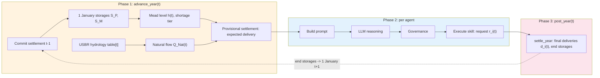

# Irrigation Water System: Physics Reference

Detailed mass balance equations, variable definitions, storage-elevation curves, and CRSS comparison for the irrigation ABM. This supplements the main [README](../README.md) Section 4.

---

## Mass Balance Equations

All quantities in MAF (million acre-feet), annual resolution. v3 water-system rewrite (2026-09-28, `irrigation_v3_spec_2026-09-28.md` WP1, plus a same-day review round): natural flow, the Mead curve, the shortage volumes, the Upper Basin/Powell priority and the Powell release rule itself all replace what the 2026-09-28 pre-rerun audits and review found wrong (L2 H1, H2, H4, D1, D2). Deliveries are still limited by what the two reservoirs can physically supply, as in Hung and Yang (2021), whose agents receive the diversion CRSS delivers. Lake Powell is a storage buffer whose release balances the two reservoirs' fill (a simplification of the 2007 Interim Guidelines, ROD Section 6 -- not the full four-tier structure: no separate equalization, Upper Elevation Balancing, Mid-Elevation Release and Lower Elevation Balancing tiers, no Lake Mead protection levels). The year's settlement, in order (`irrigation_env.py (IrrigationEnvironment._settle)`):

**1. Natural flow** (USBR calendar-year naturalized flow at Lees Ferry, no clamp)

$$Q_{Nat}(t) = \text{NaturalFlows1906-2020}\bigl[\text{year\_map}(t)\bigr], \quad \text{year\_map}: 2019\text{-}2046 \to 1988\text{-}2015,\ 2047\text{-}2060 \to 1934\text{-}1947$$

`IrrigationEnvironment._natural_flow_for_year(year)` reads the committed, sha256-checked `data/hydrology_v3.csv` (42 rows, one per simulation year; `examples/irrigation_abm/tools/build_v3_data.py` regenerates it from the source USBR workbook and documents the retrieval). No clamp: 2028 = 21.655579 MAF, 2033 = 6.088144 MAF, both outside the pre-v3 [6, 17] MAF range. A simulation year outside 2019-2060 raises rather than falling back to a synthetic value. This replaces the pre-v3 precipitation-to-flow proxy ($Q_{Nat} = 12 \times P_{winter}/100$, clamped [6, 17] MAF), which was not H&Y's CRSS hydrology (L2 H1): no same-year skill against the real record, 13% drier over 42 years, and a driest end-of-run stretch beyond anything in 1906-2018.

**2. Upper Basin non-farm consumptive use**: taken first, never curtailed, before Upper Basin agriculture and Lake Powell (spec 1.2, L2 H2)

$$Q_{Nat,net} = \max(0,\; Q_{Nat} - Q_{nf}), \qquad Q_{nf} = 1.2213 \text{ MAF (constant, USBR Upper Colorado CU\&L 2016-2020, Table UC-4, 2018)}$$

**3. Upper Basin delivery**: PI decision 4 (2026-09-28) gives the Upper Basin PRIORITY -- never cut to protect Powell's release. WP1b (item 20, 2026-09-29) replaces the single Lees Ferry pool with per-sub-basin supply as the v3 default (`config.ub_supply_mode = "subbasin"`); the single pool survives as the SI mode (`"lees_ferry_pool"`).

In `"subbasin"` mode, each of the nine Hung and Yang (2021) Upper Basin sub-basins $s$ (WY, UT1, UT2, UT3, NM, CO1, CO2, CO3, AZ; `irrigation_env.py (UB_SUBBASINS)`) has its own available water $A_s(t)$, known on 1 January (`data/ub_subbasin_supply_v3.csv`, spec 1b.1):

$$A_s(t) = c_s \times Q_s\bigl(\text{year\_map}(t)\bigr), \qquad Q_s(y) = \sum_{g \in G_s} \text{NF}_g(y), \qquad c_s = \max_{1971 \le y \le 2018} \frac{D_s(y)}{Q_s(y)}$$

$Q_s(y)$ is the USBR calendar-year total natural flow summed over sub-basin $s$'s gauges $G_s$ (`.research/design_specs/irrigation_v3_ub_subbasin_supply_2026-09-29.md` section 5 for the gauge table and the reason for each assignment); $D_s(y)$ is H&Y's own historical Upper Basin depletion series (`CRSS_DB/HistoricalData/UB_historical_annual_depletion.csv`, 1971-2018, their training period, p. 9); $c_s$ is derived, not tuned, with no margin ($\rho = 0$), so every recorded year is feasible ($c_s Q_s(y) \ge D_s(y)$) by construction. Agent $i$ in sub-basin $s$ with request $r_i$ (clipped to its water right) receives

$$d_i = r_i \times \min\Bigl(1,\; \frac{A_s(t)}{\sum_{j \in s} r_j}\Bigr), \qquad D_{UB} = \sum_i d_i$$

-- shared BY REQUEST within a sub-basin (H&Y p. 9: "the shortage is also shared based on the agent's diversion requests"), sub-basins independent of each other (no carryover storage, no routing between them). The basin-wide backstop of WP1 is kept underneath this, and the memo's own envelope never actually binds it at requests within the rights (section 5):

$$\text{if } D_{UB} > \min(5.0,\, Q_{Nat,net}), \text{ scale every } d_i \text{ by } \frac{\min(5.0,\, Q_{Nat,net})}{D_{UB}}$$

**CPU sensitivities** (WP1b re-review, MEDIUM 4, spec 1b.6; memo sections 8 and 11; `WaterSystemConfig.ub_subbasin_supply_variant`, each its own committed, checksum-pinned 42-row table): "rho_0_2" scales every sub-basin's $c_s$ by $1 + \rho = 1.2$ (H&Y's own envelope margin), same gauges as the recommended table; "lees_ferry_all" replaces every sub-basin's own gauges with the single Lees Ferry gauge (09380000); "tributary_gauges" replaces the recommended downstream/confluence gauges with the memo's own named upstream set (`MAP_TRIB`, the sub-basin memo's analysis script) -- WY 09234500+09260000 (unchanged), UT1 09302000+09306500+09328500, UT2 09315000 (unchanged), UT3 09379500 (drops the recommended Colorado R nr Cisco gauge -- UT3's own CRSS groups are on the San Juan), NM 09355500 (unchanged), CO1 09251000+09260000+09306500 (unchanged), CO2 09095500+09152500+09180000 (adds the Gunnison and Dolores the recommended single Cisco gauge omits), CO3 09355500+09180000 (unchanged), AZ 09380000 (unchanged). Reproduces the memo's own recorded short-sub-basin-year count at 2018 use exactly: rho_0_2 = 3, lees_ferry_all = 5, tributary_gauges = 12 (recommended = 19); reported, not gated.

In `"lees_ferry_pool"` mode (WP1, kept for the SI), the same 56 agents share one basin-wide pool instead of nine independent sub-basins:

$$D_{UB} = \min\bigl(\textstyle\sum r_{UB},\; 5.0,\; Q_{Nat,net}\bigr), \qquad d_i = r_i \times \frac{D_{UB}}{\sum r_{UB}}$$

Either way, this reverses the pre-v3 rule, under which the Upper Basin was cut pro-rata whenever Powell's inflow plus usable storage could not sustain a 7.0 MAF release (`ub_powell_release`, L2 D1: 12-19 years per run in the pre-v3 corpus, and the model's most-flagged reviewer risk). Real operating priority is the reverse: nothing leaves Glen Canyon Dam by gravity once Powell is at its dead pool (3,370 ft) -- releases there are limited to whatever inflow arrives that year, not a fixed 7.0 MAF floor -- and Reclamation's actual practice is to reduce Glen Canyon releases, as low as 6.0 MAF under the 2024 SEIS ROD, specifically to protect Powell rather than force a release out of an empty reservoir. The `ub_powell_release` gap reason no longer occurs; the model's own release rule (below) is likewise bounded by what is physically available, never a fixed floor regardless of storage.

**4. Lake Powell -- release PLANNING** (PI decision 2026-09-28: a storage-BALANCING rule, replacing the pass-through-with-target-fill rule of 2026-09-26; a simplification of the 2007 Interim Guidelines' balancing tiers, ROD Section 6: "the Secretary shall determine the operation of Lake Powell and Lake Mead ... to, to the extent practicable ... balance the contents of Lake Powell and Lake Mead"; re-review 2026-09-29 round 2, HIGH 1, added the projected-withdrawal term $O_{proj}$ -- the 2007 Guidelines themselves set the annual release from the 24-Month Study's PROJECTED end-of-year contents, not from live in-year demand; re-review round 3, HIGH A, moved the WHOLE planning step out of `_settle` into `IrrigationEnvironment._plan_powell_release`, called once from `advance_year` before agents decide -- HIGH 1 froze only the Lower Basin projection and left the Upper Basin side computed inline from each `_settle` call's own ACTUAL request, so a mid-year Upper Basin request change still moved the release, reviewer's probe: 16 of 42 years, up to 0.237 MAF).

Every quantity below carries a `,proj` planning-time subscript, computed from the frozen 1 January storages/flow and PROJECTED (carried, pre-decision) request totals for BOTH basins -- never from whatever a particular `_settle` call is actually settling. $D_{UB,proj} = \min(r_{UB,proj},\, 5.0,\, Q_{Nat,net})$ (`_ub_delivery_for_planning`; WP1b, spec item 20, replaces this single 5.0 MAF-capacity formula with the sum over sub-basins of $\min$(that sub-basin's projected requests, its own availability $A_s$) -- the one seam that change touches). $I_{P,proj} = Q_{Nat,net} - D_{UB,proj}$. $E_{P,proj}$ is capped at usable storage plus $I_{P,proj}$ (review fix 1: not the pre-Upper-Basin $Q_{Nat,net}$ -- letting Powell "evaporate" water the Upper Basin already took could push storage below the dead pool). The planned release $R_{plan}$ is chosen so the two reservoirs' end-of-year LIVE-storage fractions ($f_P$, $f_M$) are as close as possible AFTER that year's projected Lower Basin withdrawals, bounded to $[7.0, 9.5]$ MAF -- the Lower Elevation Balancing Tier's own band (ROD p. 52: "not more than 9.5 maf and not less than 7.0 maf") -- and to what the PROJECTED inflow/storage can support:

$$O_{proj} = r_{LB,proj} + N_{delivered} + M_{DCP}(h), \qquad A_{P,proj} = S_P + I_{P,proj} - E_{P,proj} - S_{P,dead}, \qquad B_{M,proj} = S_M + T - E_{M,est} - O_{proj} - S_{M,dead}$$

$$R_{raw} = \frac{L_M A_{P,proj} - L_P B_{M,proj}}{L_P + L_M}, \qquad R_{plan} = \min\Bigl(\max(R_{raw},\, 7.0),\, 9.5,\; I_{P,proj} + S_P - S_{P,dead} - E_{P,proj}\Bigr)$$

where $r_{UB,proj}$ and $r_{LB,proj}$ (`ub_request_projected_maf` / `lb_request_projected_maf`, computed in `advance_year`, the latter frozen since HIGH 1) are each basin's request total at each agent's then-current, pre-decision (CARRIED) request -- MEDIUM B: this is the carried request, not necessarily last year's actual receipt (WP2 resets a carried request to last year's receipt before this sum runs; WP1 has no such reset, so the two need not coincide here). $N_{delivered}$ and $M_{DCP}(h)$ are already frozen at the snapshot (step 5, step 1's Mexico schedule from last year's end-of-year Mead elevation). $L_P = S_{P,cap} - S_{P,dead}$ (Powell's live capacity, 24.32 MAF) and $L_M = S_{M,cons} - S_{M,dead}$ (Mead's live capacity to the conservation-pool top, 26.1 MAF -- not the curve's flood-control ceiling, see fix 11 below). The four named tiers (equalization, Upper Elevation Balancing, Mid-Elevation Release, Lower Elevation Balancing) collapse into this one rule; the release band itself is the Lower Elevation Balancing Tier's own bound. Not a quoted Guidelines formula (no source publishes a live-fraction-equalizing release equation); the QUOTED numbers it uses are the band (7.0-9.5 MAF, ROD p. 52) and the balancing INTENT (ROD Section 6). $R_{plan}$ is stored in the snapshot as `powell_release_planned_maf` -- computed exactly ONCE per year, in `advance_year`, before the provisional `_settle` call and every later one this same year.

**4b. Lake Powell -- release APPLICATION** (`_settle`, every call, provisional and final): the release actually delivered can only be capped DOWN from the plan by THIS call's own ACTUAL physical availability -- never re-derives the target itself:

$$D_{UB} = \text{step 3's formula (subbasin or lees\_ferry\_pool)}, \qquad I_P = Q_{Nat,net} - D_{UB}, \qquad E_P = \min\bigl(E_P^{raw}(S_P),\; (S_P - S_{P,dead}) + I_P\bigr)$$

$$R = \min\bigl(R_{plan},\; I_P + (S_P - S_{P,dead}) - E_P\bigr), \qquad S_P(t+1) = \min\bigl(S_P + I_P - E_P - R,\; S_{P,cap}\bigr) \quad(\text{excess spills into } R)$$

$D_{UB}$ here uses this call's ACTUAL Upper Basin requests (step 3's formula, unchanged by WP1b's planning-side seam) -- distinct from step 4's $D_{UB,proj}$. The physical cap may legitimately move release below $R_{plan}$ (e.g. a drier year than projected, or Powell already low); the plan itself never does.

**5. Lake Mead withdrawals**: PI decision 2026-09-28 (replacing the pro-rata-across-all-Lower-Basin-use rule) -- the declared shortage volume $V_\tau$ (2007 Interim Guidelines, Section 2.D.1: 0 / 0.333 / 0.417 / 0.500 MAF for tiers 0-3) is borne ENTIRELY by the 5.0 MAF non-agricultural bucket $N$, the model's stand-in for CAP and Southern Nevada (ROD Section 2.D, p. 36-37: shortages reduce Arizona and Nevada, California stays at 4.4 MAF; Colorado River Compact Decree Art. II(B)(3) priority order). The 22 Lower Basin agricultural agents are senior mainstem/California entitlement holders and are NOT reduced by the declared tier -- a simplification: a few Arizona fourth-priority mainstem contracts in reality share shortages with CAP, modelled here as senior like the rest. Mexico per Minute 323 / the Binational Water Scarcity Contingency Plan.

$$N_{delivered} = \max(0,\, N - V_\tau), \qquad O = \textstyle\sum r_{LB} + N_{delivered} + M_{DCP}(h)$$

This replaces the pre-v3 flat 0/5/10/20 percent cuts (L2 D2), which were not derived from the 2007 Guidelines, AND the WP1 pro-rata-across-all-use rule reviewed the same day (which cut agricultural deliveries too, contrary to the Guidelines' actual priority order).

**6. Lake Mead availability**: withdrawals cannot exceed storage above the dead pool plus the year's inflow; when they would, every Lower Basin withdrawal (agricultural and non-agricultural alike) and Mexico's delivery are scaled by the same $\phi$

$$A = (S_M - S_{M,dead}) + R + T - E_M, \qquad \phi = \min(1,\; A / O)$$

$$S_M(t+1) = S_M(t) + R + T - E_M - \phi\, O, \qquad S_M \le S_{M,cons} \text{ (excess spills below Hoover)}$$

$T$, the Lower Basin tributary inflow (Lees Ferry to below Hoover Dam), is the USBR natural intervening flow of the same mapped historical year by default (mean 0.793 MAF over 2019-2060; `config.lb_tributary_source = "usbr_intervening"`, REQUIRED in the snapshot for this source -- no silent fallback, fix 8), or the constant 1.0 MAF for the CPU sensitivity (`"constant"`, the only source allowed to omit it). $S_{M,dead}$ = 2.547 MAF and $S_{M,cons}$ = 28.647 MAF (the conservation-pool top, fix 11 -- see the Storage-Elevation Curve section; DISTINCT from $S_{M,cap}$ = 30.167 MAF, the curve's true endpoint at 1,229 ft, which includes flood-control space real operations do not fill). The former $\pm 3.5$ MAF clamp on the annual Mead storage change is retired (Powell storage now does the buffering, and the clamp broke mass conservation). Both balances close exactly:

$$\Delta S_P + \Delta S_M = Q_{Nat} - Q_{nf} + T - D_{UB} - E_P - E_M - \phi\, O - spill_M$$

(`examples/irrigation_abm/tests/test_v3_water_system.py (TestMassBalanceClosureV3)` and `tests/test_irrigation_supply_side.py (TestMassBalance)` check this for full 42-year runs and thousands of random states.)

**7. Agent delivery** ($r_i$ = request, capped at the water right $w_i$): step 3's per-agent formula ($d_i = r_i \min(1, A_s(t)/\sum_{j \in s} r_j)$ in `subbasin` mode, $d_i = r_i D_{UB}/\sum r_{UB}$ in `lees_ferry_pool` mode), for Lower Basin $d_i = r_i\,\phi$ (agricultural -- no tier factor).

Each agent also carries a `gap_reason` code. Upper Basin: `none`; `ub_subbasin_supply` (WP1b, `subbasin` mode only -- this agent's OWN sub-basin's $A_s(t)$ bound, the basin-wide backstop did not); `ub_natural_flow` (the basin-wide backstop bound because natural flow, net of non-farm use, was the tighter bound -- in `subbasin` mode this overrides `ub_subbasin_supply` for every Upper Basin agent, even one whose own sub-basin was not itself short) or `ub_capacity` (the 5.0 MAF backstop bound instead). Lower Basin (agricultural) `none` or `lb_mead_availability` only. `lb_shortage_tier` no longer occurs for an agricultural agent (PI decision 2026-09-28: the declared tier reduces only the non-agricultural bucket) and `ub_powell_release` no longer occurs either (PI decision 4). The declared tier stays visible as information via `curtailment_ratio` = $V_\tau / N$ (the share of the non-agricultural bucket removed), read by governance rules that need to know a tier is in effect without implying it reduced an agricultural agent's own delivery.

### Auxiliary Equations

**Evaporation** (Lake Powell: storage fraction of capacity; Lake Mead: SURFACE-AREA proxy, fixed 2026-09-28 -- a lake evaporates from its surface, not its volume, and volume and area are not proportional for a natural basin; taken on the 1 January storage and never below a dead pool):

$$E_M(S) = 0.541 \times \max\!\left(0.15,\; \min\!\left(\frac{A(h(S))}{A(h_{2018})},\; 1.50\right)\right), \qquad E_P(S) = 0.70 \times \max\!\left(0.15,\; \min\!\left(\frac{S}{26.21},\; 1\right)\right)$$

$h(S)$ is the elevation for storage $S$ (the USBR 2009 curve); $A(h)$ is a surface-area PROXY -- the curve has no area column, so the local slope $dS/dh$ on its 1-ft grid stands in for it (proportional to true area for a smoothly-varying basin; only ever used as a ratio, so the proportionality constant cancels). $h_{2018}$ = 1,081.46 ft, the WY2018 Mead condition (`mead_evap_ref_storage_maf` = 12.679 MAF: 10.132 MAF available capacity at that elevation, USBR 2009 curve, plus the 2.547 MAF dead storage): since $A(h_{2018})/A(h_{2018}) = 1$, $E_M(12.679) = 0.541$ MAF exactly (PI decision 5, 2026-09-28), the February 2019 24-Month Study's reported WY2018 Mead evaporation. $E_P$ is unchanged by v3 (still a storage-fraction proxy, not converted to a surface-area one).

### Lake Powell constants and sources

Re-verified 2026-09-26 against primary USBR/USGS sources
(`.research/powell_constants_verification_2026-09-26.md`). Total capacity is
VERIFIED outright; the raw inputs behind the 1 January 2019 storage and the
evaporation figure are VERIFIED, but each stored value also folds in a
modelling step (the dead-pool split, or a 0.55 storage-fraction scale-up)
that is not itself independently confirmed; the dead pool remains a
calibrated aggregate without a single primary table; the release band is a
quoted Guidelines figure (below), but the storage-balancing rule that uses
it is a modelling simplification, not a quoted formula.

| Constant | Value | Source |
| :------- | :---- | :----- |
| Total capacity at full pool (3,700 ft) | 26.21 MAF | VERIFIED. 1986 area-capacity table (used by USBR operations through 2019). USGS (2022), ["Lake Powell's storage capacity updated for first time since 1986"](https://www.usgs.gov/news/national-news-release/lake-powells-storage-capacity-updated-first-time-1986) (full report: [USGS SIR 2022-5017](https://pubs.usgs.gov/sir/2022/5017/sir20225017.pdf)): 25.160 MAF in the 2018 survey, a 1.048 MAF loss since 1986 |
| Dead-pool storage (below 3,370 ft) | 1.89 MAF | CALIBRATED AGGREGATE, not a single primary table. 26.21 MAF total minus 24.322 MAF live capacity (a widely repeated operational convention, secondary sources only); order of magnitude ("about 1.9-2.0 MAF") corroborated but the primary 1986 USBR area-capacity table ([RISE catalog item 11372](https://data.usbr.gov/catalog/4575/item/11372)) was not opened |
| Storage on 1 January 2019 | 11.99 MAF total (10.099 MAF live) | Live storage (10.099 MAF) VERIFIED; the 11.99 MAF total is contingent on the calibrated 1.89 MAF dead-pool split above, not independently verified. [USBR Lower Colorado Region, February 2019 24-Month Study](https://www.usbr.gov/lc/region/g4000/24mo/2019/FEB19.pdf) (Most Probable), Lake Powell table: end of December 2018, 3,581.85 ft, 10,099 thousand acre-ft live |
| Evaporation at full pool | 0.70 MAF/yr | The RAW water year 2018 input (386 thousand acre-ft) is VERIFIED against the same 24-Month Study, at about 12.5 MAF mean live storage (0.55 of capacity); the stored 0.70 MAF full-pool figure (0.386 / 0.55) is the model's own scale-up, not itself quoted |
| Release band | [7.0, 9.5] MAF/yr | QUOTED: the Lower Elevation Balancing Tier's own bound (2007 ROD p. 52, "not more than 9.5 maf and not less than 7.0 maf"). 7.0 MAF is also quotable as that tier's floor, not the "minimum objective release" (that is 8.23 MAF/yr, Upper Elevation Balancing Tier -- also the *initial* WY2019 release volume; the actual WY2019 release was 8.91 MAF). The Mid-Elevation Release Tier releases 7.48 MAF below a Mead-elevation threshold in the Guidelines' own tier table, 8.23 MAF above it. Superseded 2026-09-28: the model's earlier 9.0 MAF ceiling (2026-09-26) and 0.42 target-fill fraction were modelling choices, not Guidelines figures; both are retired now that a balancing rule uses the Guidelines' own 9.5 MAF band directly. |

The 2018 survey gives about 1 MAF less capacity than the 1986 table; the model uses the 1986 table because the Dec 2018 storage it starts from was reported on that table.

**Powell elevation, for reporting only (spec 1.8, L2 A2).** No storage-elevation curve is used in the physics (Powell's balance is entirely in total-storage MAF); the four points below (2007 ROD tier table, p. 49) are enough to convert a reported storage series to an approximate elevation for a figure or a crossing-year count, by linear interpolation on live storage (total storage minus the 1.89 MAF dead pool):

| Live storage (MAF) | Elevation (ft) |
| :------------------ | :------------- |
| 0 (dead pool) | 3,370 |
| 5.93 | 3,525 |
| 9.52 | 3,575 |
| 24.32 (full pool) | 3,700 |

---

## Variable Definitions

| Symbol | Definition | Value / Unit |
| :----- | :--------- | :----------- |
| $S_M$, $S_P$ | Lake Mead, Lake Powell total storage (1 January) | MAF |
| $h$ | Lake Mead elevation (USBR 2009 area-capacity curve) | ft |
| $Q_{Nat}$ | Natural flow at Lees Ferry (USBR calendar-year naturalized flow, `data/hydrology_v3.csv`) | MAF/yr |
| $Q_{nf}$ | Upper Basin non-farm consumptive use (constant) | 1.2213 MAF/yr |
| $P_g$ | Agent's own sub-basin winter precipitation (information only, not a driver of $Q_{Nat}$) | mm |
| $D_{UB}$ | Upper Basin delivered total | MAF/yr |
| $R$ | Powell release to Mead | MAF/yr |
| $T$ | Lower Basin tributary inflow, Lees Ferry to below Hoover Dam (USBR intervening flow of the mapped year, or a constant) | MAF/yr |
| $O$ | Scheduled Lower Basin withdrawals from Mead (after the shortage cut) | MAF/yr |
| $A$ | Water Mead can deliver this year | MAF/yr |
| $\phi$ | Physical delivery ratio at Mead | [0, 1] |
| $D_{muni}$ | Municipal/M&I demand (CAP + MWD + losses) | 5.0 MAF/yr |
| $M_{DCP}(h)$ | Mexico treaty delivery (elevation-dependent, Minute 323 / BWSCP) | MAF/yr |
| $E_M$, $E_P$ | Reservoir evaporation (storage-dependent) | MAF/yr |
| $r_i$ | Agent $i$ request (post-governance, capped at $w_i$) | AF/yr |
| $w_i$ | Agent $i$ water right (see note below) | AF/yr |
| $V_\tau$ | Lower Basin shortage volume for tier $\tau$ (2007 ROD Section 2.D.1: 0, 0.333, 0.417, 0.500 MAF) | MAF/yr |
| $\gamma_\tau$ | Declared-tier informational ratio, $V_\tau / D_{muni}$ (re-review 2026-09-29: the non-agricultural bucket's own share; PI decision 2026-09-28 stopped applying it to agricultural deliveries, so $\sum r_{LB}$ no longer appears in the denominator) | [0, 1] |
| $d_i$ | Agent $i$ delivered water (`diversion` in the code and logs) | AF/yr |

F10 (2026-09-25 audit; ceiling fixed 2026-09-26, water-right
history-anchor): `col.iloc[-1]` of that agent's
`Div_States/*_discrete_states.csv` is the TOP of the discretised FQL
diversion grid (Hung & Yang's `Div_max`), not a legal Colorado River
entitlement. For the 56 modelled Upper Basin agents that grid top sums
to 10.54 MAF, 2.8x their 1971-2018 observed peak (3.54 MAF) and 3.5x
their 2018 use (3.05 MAF); at that ceiling requests grow to 7-10 MAF
within a few years, hit the 5.0 MAF Upper Basin delivery capacity from
year 2, and Lake Powell sits at dead pool for roughly half the run
(Lower Basin grid tops are milder, 1.24x their observed peak: 4.27 MAF
vs 3.43 MAF).

$w_i$ is now $\min(w_i^{grid}, (1 + m) \cdot w_i^{peak})$ for every agent
in both basins (one rule): $w_i^{grid}$ is the grid top above, $w_i^{peak}$
is that agent's own observed peak diversion over 1971-2018 (the same
per-agent historical series `actual_2018_diversion` reads; Upper Basin
agents split their state group's series proportionally, exactly as
`actual_2018_diversion` does), and $m$ = `paper_water_margin` (default
0.4, on [0, 1]) is the share by which a district's legal ceiling may
exceed its observed peak.

Derivation of the default: the 56 modelled Upper Basin agents used
3.0544 MAF in 2018. USBR's "Upper Colorado River Basin Consumptive Uses
and Losses 2016-2020" (Provisional, Feb 2022), Table UC-4, gives 2018
Upper Basin irrigation consumptive use as 3,079.3 kaf (within 1% of the
modelled agents' figure) against a 2018 Upper Basin total, including
main-stem reservoir evaporation, of 4,752.8 kaf -- irrigation's share of
2018 Upper Basin consumptive use is 3,079.3 / 4,752.8 = 0.648 (evaporation
is included in the denominator because Compact accounting charges
reservoir evaporation to the basin's apportionment). That share of the
7.5 MAF Compact Article III(a) apportionment is 0.648 x 7.5 = 4.86 MAF;
dividing by the 56 agents' observed-peak sum (3.536 MAF) gives
4.86 / 3.536 = 1.374, rounded to one decimal, 1.4 -- a margin of 0.4 over
the observed peak (`paper_water_margin`, exposed as
`--paper-water-margin` on `run_experiment.py` and `run_fql_baseline.py`).
The Lower Basin is bound by the same rule and the same
`paper_water_margin` (not a separate per-basin value); its 22 grid tops
stay the binding value for a narrow majority of agents, the peak-scaled
ceiling for the rest.

At the default, the 56 Upper Basin agents' new $w_i$ sums to about
4.93 MAF, below the 5.0 MAF Upper Basin delivery capacity (no agent
falls below its own 2018 use), and the 22 Lower Basin agents' sums to
about 4.18 MAF. A margin of 0.5 would put the Upper Basin sum at about
5.28 MAF, above the delivery capacity; a margin of 0.0 (the bare
observed peak, no margin) leaves most Upper Basin agents almost no room
to increase, since their peak-to-2018-use ratio has a median of about
1.01. See `irrigation_personas.py (create_profiles_from_data)` for the
implementation and `docs/irrigation_model_caveats.md` (item 11) for the
disclosure-side note.

---

## Implementation Pseudocode

From `irrigation_env.py (IrrigationEnvironment.advance_year, settle_year, _settle)` and `run_experiment.py (IrrigationLifecycleHooks.post_year)`:

```text
advance_year(t)                          [before any agent decides]
  |-- 1. commit settlement(t-1): end storages -> 1 January storages of t
  |        (settles now at the final requests if settle_year() was never called)
  |-- 2. _generate_precipitation()          <- P_g(t) per UB sub-basin group, from CRSS PRISM
  |        Q_Nat = hydrology_v3.csv[year]    <- USBR naturalized flow, no clamp, independent of P_g
  |-- 3. h(t) = elevation(S_M on 1 January) <- appended to the Mead history
  |-- 4. _update_preceding_factors(), _compute_drought_index()  [drought_index: legacy, unread]
  |-- 5. tier from h(t); V_tau (2007 ROD volume); gamma = V_tau / N (informational only, re-review
  |        2026-09-29 -- no carried-r_LB term any more, PI decision 2026-09-28)
  |        _apply_curtailment(gamma)         <- gamma on LB agents (informational), 0 on UB
  |-- 5b. r_UB,proj, r_LB,proj = sum of each basin's agents' CURRENT (pre-decision, CARRIED)
  |        request [HIGH 1 froze r_LB,proj; HIGH A round 3 adds r_UB,proj]
  |-- 5c. R_plan = _plan_powell_release(NF, S_P, S_M, T, V_tau, Mexico, r_UB,proj, r_LB,proj)
  |        [HIGH A round 3: the release ITSELF, not just its inputs, is now decided here --
  |        _settle no longer re-derives any release target, only applies a physical cap]
  |-- 6. freeze the 1 January snapshot (NF, V_tau, tributary T, Mexico, r_LB,proj, R_plan,
  |        calendar_year); PROVISIONAL _settle() at the carried requests -- applies R_plan
  |        capped by THIS call's own actual physical availability
  |        -> each agent's expected delivery, delivery_ratio, gap_reason
  +-- 7. total_basin_demand, basin_request_over_target (= total / 5.86 MAF)
decisions                                 execute_skill -> update_agent_request
post_year(t) -> settle_year()             FINAL _settle() at this year's requests, from the
                                          frozen snapshot; idempotent; not committed until t+1
                                          _apply_curtailment(gamma) again (same gamma; spec 1.5)
```

---

## Action Model (Hung and Yang 2021)

v3 (WP2, `irrigation_v3_spec_2026-09-28.md` section WP2, 2026-09-29): the agent's decision changes its diversion REQUEST relative to its BASE -- last year's COMMITTED DELIVERY (`IrrigationEnvironment._reset_requests_to_base`, run once a year, before anything sums requests or plans the Powell release, so the Powell plan, the provisional settlement and the supply rule all see the keep request too), matching Hung and Yang (2021, p. 4: a new request is last year's received diversion plus the chosen change) -- not the agent's own carried request, as an earlier version applied the step to. The LLM chooses only the DIRECTION (`increase_demand`, `maintain_demand`, `decrease_demand`); the water balance above decides what the resulting request actually receives. The size of the change follows `ref/RL-ABM-CRSS/ABM_CRSS_coupling.py (Q_learning)`:

$$\Delta r_i = \pm\,(\mu_i + |z|)\, s_i, \qquad z \sim N(0, \sigma_i)$$

- $\mu_i, \sigma_i$: agent $i$'s calibrated parameters (`ALL_colorado_ABM_params_cal_1108.csv`, rows `mu`, `sigma`); data, not tunables.
- $s_i$: agent $i$'s FINAL step bin (`step_bin_af`), derived from the step of its discretised diversion grid, $b_i$ = `agt_states[2] - agt_states[1]` of `Div_States/*_discrete_states.csv` (acre-ft; data), converted to this agent's own delivery units: $b_i' = k_i b_i$, with $k_i = 0.5$ in the Upper Basin (the grid is in diversion units; Hung and Yang 2021, p. 9, assume 50% of a diversion is depleted) or $1.0$ in the Lower Basin (`demand_per_grid_unit`). Where $b_i'$ exceeds 20% of the agent's 2018 use, $s_i$ is instead 10% of that use (Hung and Yang 2021, p. 8's own description of the grid increment as "approximately 10% of the 2018 diversion") -- exactly 8 agents (the 3 Upper Basin ArizonaMiscUses agents; CocopahIndRes, CRIR CA, Chemehuevi Ind Res, Powers, CibolaValleyIDD in the Lower Basin); otherwise $s_i = b_i'$.
- The LLM picks only the sign; the environment draws $|z|$ from the WHOLE H&Y half-normal distribution (`hy_step_af(rng, mu, sigma, step_bin_af, "any")`) regardless of direction -- no small/large split (closer to Hung and Yang 2021, p. 4, whose own model has none either). `hy_step_af` draws $|z|$ by inverse CDF from one uniform of the per-(seed, year, agent, skill) stream. The agent is shown its typical step, the median of its own distribution, $T_i = (\max(0,\mu_i) + 0.6745\,\sigma_i)\,s_i$ (`hy_threshold_af`), in every option's text.
- Bounds: an increase is $\min(\text{base}_i + \Delta r_i,\, w_i)$ (water right); a decrease is $\max(\text{base}_i - \Delta r_i,\, F_i)$, $F_i = 0.1\,w_i$ (minimum use), ONLY when $\text{base}_i > 1.01\,F_i$ -- otherwise the decrease is a no-op (never raises a request that starts below the floor back up to it; 4 Lower Basin agents start there). No taper, no magnitude exploration (H&Y explore over direction only).
- Fallbacks (mock runs only): $s = w/25$ whenever a profile has no grid step; $\mu = 0.218$, $\sigma = 0.923$ (CSV medians) when the environment builds agents itself; synthetic profiles from the runners keep their cluster-centroid $\mu, \sigma$.
- The FQL reference model (`run_fql_baseline.py`) keeps its own state discretisation on the ORIGINAL, unconverted diversion-unit grid (`hy_bin_size = bin_size_af / demand_per_grid_unit`, undoing the Upper Basin conversion above for that one use) -- see `docs/irrigation_model_caveats.md` item 11.

---

## Mexico DCP Reductions (Minute 323 / BWSCP)

When Lake Mead elevation drops, Mexico's delivery is reduced under Minute 323 and the Binational Water Scarcity Contingency Plan (BWSCP). v3 (PI decision 6, 2026-09-28) adds the four 5-ft bands between 1,045 and 1,025 ft the pre-v3 code collapsed into one (L2 N2):

| Mead Elevation | Mexico Reduction | Effective Delivery |
| :------------- | :--------------- | :----------------- |
| >= 1090 ft | 0 | 1.500 MAF |
| 1075-1090 ft | 0.041 MAF | 1.459 MAF |
| 1050-1075 ft | 0.080 MAF | 1.420 MAF |
| 1045-1050 ft | 0.104 MAF | 1.396 MAF |
| 1040-1045 ft | 0.146 MAF | 1.354 MAF |
| 1035-1040 ft | 0.154 MAF | 1.346 MAF |
| 1030-1035 ft | 0.162 MAF | 1.338 MAF |
| 1025-1030 ft | 0.171 MAF | 1.329 MAF |
| < 1025 ft | 0.275 MAF | 1.225 MAF |

Review 2026-09-28 (fix 3): each of the four new bands is the 70 kaf Minute 323 base reduction below 1,045 ft (DOI 2022 press release: the 104 kaf total reduction at 1,050-1,045 ft minus its 34 kaf BWSCP saving = 70 kaf Minute 323 base) plus that band's own BWSCP saving (IBWC 2019 Joint Report of the Principal Engineers, Binational Water Scarcity Contingency Plan: 76 / 84 / 92 / 101 kaf for the four bands), giving 146 / 154 / 162 / 171 kaf -- replacing the earlier single 158.5 kaf midpoint used pending this derivation.

---

## Storage-Elevation Curve

Lake Mead storage-to-elevation is interpolated from the USBR 2009 area-capacity survey (Tighi and Callejo, 2011): 335 points at 1-ft steps from 895 to 1,229 ft, in `data/mead_capacity_usbr2009_1ft.csv` (sha256-checked at load; `examples/irrigation_abm/tools/build_v3_data.py` documents the source and regenerates it), loaded into `IrrigationEnvironment._ELEVATION_FT` / `_STORAGE_MAF` (total storage = the file's "available capacity above 895 ft" plus the 2.547 MAF dead storage). v3 (spec 1.4, L2 H4) replaces the earlier 10-point curve, which did not match this table (non-physical between 1,000 and 1,050 ft: that band held MORE water than the band above it, impossible when surface area grows with stage) and understated capacity by up to 46% in places.

**Total versus operational storage (review 2026-09-28, fix 11).** The curve's true endpoint, `mead_capacity_maf` = 30.167 MAF at 1,229 ft, is TOTAL storage INCLUDING the flood-control space above the conservation pool (about 1,219.6 ft, where available capacity is 26.1 MAF above the dead pool). Real operations do not fill that space; `_settle` treats storage above `mead_conservation_pool_maf` = 28.647 MAF (2.547 dead storage + 26.1 MAF conservation pool) as spill, not as retainable storage -- the curve still interpolates up to 30.167 MAF (so elevation stays defined for any total storage that far), but the water balance never intentionally holds Mead there. Every Mead quantity in this module -- `mead_dead_pool_maf`, `mead_conservation_pool_maf`, `mead_capacity_maf`, `mead_evap_ref_storage_maf` -- is TOTAL storage (dead storage included), the one convention used throughout; nothing here is a "live storage" figure requiring a separate conversion.

---

## Agent-Reservoir Feedback Loop



Natural flow $Q_{Nat}(t)$ comes from the committed USBR hydrology table by simulation year, not from precipitation (spec 1.1) -- winter precipitation $P_g(t)$ is a SEPARATE signal shown to Upper Basin agents only (per sub-basin group), with no edge into $Q_{Nat}$.

| Step | Equation | Constants |
| :--- | :------- | :-------- |
| 1 Natural flow | $Q_{Nat}(t)$ = `data/hydrology_v3.csv` row for year $t$ | no clamp; $Q_{nf}$ = 1.2213 MAF non-farm use taken first |
| 2 Upper Basin delivery | `subbasin` (v3 default, WP1b): nine independent sub-basin supplies $A_s(t)$, shared by request within a sub-basin; `lees_ferry_pool` (SI): $D_{UB} = \min(\sum r_{UB},\, 5.0,\, Q_{Nat}-Q_{nf})$ | pro-rata within the relevant scope; NEVER cut for Powell's release |
| 3 Powell | $S_P' = S_P + I_P - E_P - R$; $R$ chosen to equalize Powell's and Mead's live-storage fractions, bounded to [7.0, 9.5] MAF, never more than available | dead pool 1.89, capacity 26.21 MAF |
| 4 Mead withdrawals | $O = \sum r_{LB} + \max(0, 5.0 - V_\tau) + M_{DCP}(h)$ | declared volume $V_\tau$ cuts the non-agricultural bucket only, not agricultural requests |
| 5 Mead | $S_M' = S_M + R + T - E_M - \phi O$, $\phi = \min(1, A/O)$ | $S_M \in [2.547,\, 28.647]$ (conservation pool; curve extends to 30.167 MAF) |
| 6 Delivery | $d_i = r_i D_{UB}/\sum r_{UB}$ (UB), $r_i \phi$ (LB agricultural, no tier factor) | |

**Feedback loop**: Over-extraction lowers Mead, a lower 1 January level declares a higher tier, the Lower Basin cut grows and Lower Basin increases are blocked, requests level off or fall, Mead recovers, the tier drops. Requests made in year $t$ are settled in year $t$; their effect on storage is seen by agents on 1 January of $t+1$.

---

## Comparison with Full CRSS

| Aspect | Our Model | Full CRSS |
| :----- | :-------- | :-------- |
| Temporal resolution | Annual | Monthly |
| Spatial resolution | 2 basins (UB/LB) | 3,700+ objects |
| Reservoir model | Powell and Mead storage stocks | Powell + Mead + Flaming Gorge + ... |
| Operating rules | Powell storage-balancing release bounded to [7.0, 9.5] MAF (simplified 2007 ROD Section 6), Upper Basin priority; Mead shortage VOLUMES by tier (2007 ROD), borne by the non-agricultural bucket only | Full Interim Guidelines (four balancing tiers) + DCP + Minute 323 |
| Demand model | 78 LLM agents | Exogenous demand schedules |
| Precipitation | CRSS PRISM (real), agent information only | CRSS PRISM (same source), agent information only |
| Natural flow | USBR calendar-year naturalized flow at Lees Ferry (`data/hydrology_v3.csv`), the same resampled trace CRSS used (H&Y 2021, p. 15) | Full hydrologic routing, this trace as the boundary condition |
| Agent feedback | Bidirectional | None (exogenous demand) |

**Key advantage**: Bidirectional coupling (agent demand <-> reservoir state) enables studying how governance rules affect collective demand trajectories, something standard CRSS cannot do because it uses fixed exogenous demand schedules.

---

## Two-Reservoir Simplification (what is and is not modelled)

Before the 2026-09-25 supply-side redesign the model tracked Lake Mead only: the Powell release was natural flow minus Upper Basin use, the 7.0 MAF minimum release was enforced by capping Upper Basin use at $\max(0, Q_{Nat} - 7)$ (so every Upper Basin agent received 0 in a 6.0 MAF year such as 2022, audit finding F11), and a $\pm 3.5$ MAF clamp on the annual Mead storage change stood in for Glen Canyon buffering. F11b (same day) made that cap survive each agent's own decision by re-applying it once after the decision loop.

The redesign keeps the F11b pattern (one idempotent settlement after the decision loop, rebuilt from requests and a frozen 1 January snapshot) and replaces the physics:

* Lake Powell is a storage stock between 1.89 MAF (dead pool) and 26.21 MAF (full pool), starting from the USBR end-of-2018 storage. Review 2026-09-28: it releases R chosen to equalize Powell's and Mead's end-of-year live-storage fractions (a simplification of the 2007 ROD's balancing tiers, Section 6), bounded to [7.0, 9.5] MAF (the Lower Elevation Balancing Tier's own band) and never more than inflow plus usable storage (pass-through at dead pool). Superseded the same day: the 2026-09-26 rule (pass-through clamped to [7.0, 9.0] MAF, wet-year retention only up to a 0.42-of-live-capacity target fill) is retired along with `powell_target_fill`; see the stale table below for its measured behaviour. It spills above full pool.
* v3 (PI decision 4, 2026-09-28): the Upper Basin has PRIORITY and is bounded only by (non-farm-net) natural flow and the 5.0 MAF delivery capacity -- it is NEVER cut to protect Powell's release. (Superseded: before this decision, Upper Basin use was cut pro-rata whenever Powell's usable storage could not cover the 7.0 MAF floor; see the stale table below.)
* Lake Mead deliveries cannot exceed its usable storage plus inflow, up to the conservation-pool top (28.647 MAF, review fix 11 -- not the curve's flood-control ceiling); when they would, all Lower Basin withdrawals and Mexico's delivery are scaled pro-rata.
* Review 2026-09-28: the declared shortage VOLUME (2007 ROD, 0 / 0.333 / 0.417 / 0.500 MAF by tier) is borne entirely by the 5.0 MAF non-agricultural bucket (the Guidelines' actual juniors), never by the 22 agricultural agents' own requests -- a correction of the same-day WP1 version, which (like the pre-v3 flat 0/5/10/20 percent cut) had shared it pro rata across all Lower Basin use, contrary to the Guidelines' priority order (ROD Section 2.D, Decree Art. II(B)(3)).
* The $\pm 3.5$ MAF clamp is retired; mass balance closes.

Not modelled, on purpose (simplification to disclose): the Interim Guidelines' four SEPARATE Powell release tiers (equalization, Upper Elevation Balancing, Mid-Elevation Release, Lower Elevation Balancing -- collapsed here into one storage-balancing rule within the Lower Elevation Balancing Tier's own [7.0, 9.5] MAF band), Lake Mead protection levels, Drought Response Operations, and Flaming Gorge.

**Consequence to disclose (measured 2026-09-26, 42 years on the CRSS PRISM series; STALE as of the v3 water-system rewrite, 2026-09-28 -- L2 D7 -- kept as the historical record of the 2026-09-25 supply-side redesign decision, not the current physics).** Every row below still uses the pre-v3 precipitation-scaled hydrology, the pre-v3 Mead curve and the pre-v3 flat tier percentages; regenerating this table against the v3 water system is deferred to the WP7 release commit (`irrigation_v3_spec_2026-09-28.md`), once a full corpus exists to measure. Old = the pre-redesign Mead-only balance (fcd74a5f). The redesign went through four Powell release rules: pinned at 7.0 MAF (fe72e43f), pass-through with a 7.0 MAF floor (option c, dc503b5d), pass-through clamped to [7.0, 9.0] MAF (option d, 56c33faf), and option (e): the same band with wet-year retention only up to the 2019 fill.

**`lees_ferry_pool` mode (WP1, the SI) fixed-2018-demand trajectory, re-review 2026-09-29 (HIGH 1 and HIGH A fixes applied)**, 42 years, the REAL 78-agent CRSS run (`create_profiles_from_data` + `initialize_from_profiles`, every request held at its v3 base value all 42 years -- LOW C, re-review round 3: an earlier draft of this note mislabeled this a "synthetic 24-agent" replay; confirmed on two independent seeds, 7 and 42, to 4 decimal places, since the aggregate is set by the real CRSS demand data, not the profile RNG seed; also pinned as a regression in `test_real_2018_fixed_demand_42_years_pool_mode`): neither reservoir ever reaches its dead pool; Powell never spills; Mead never spills; shortage tiers 0/1/2/3 occur in 20/11/8/3 of the 42 years; Powell release ranges 7.0-9.5 MAF (mean 8.70); end-of-year live fractions $f_P$ range 0.123-0.992 and $f_M$ range 0.184-0.510, mean $|f_P - f_M|$ = 0.103 (the bounds bind often enough that equalization is partial by design, not a bug); Mead's minimum 1 January storage is 7.352 MAF (1,005.8 ft) -- close to the reviewer's own independently-measured 1,005.8 ft for the corrected (O-inclusive) rule, and a sharp improvement on the pre-HIGH-1 rule's measured Powell-full-and-spilling-while-Mead-sat-in-Tier-1, 12 Tier-3 years, minimum 985.4 ft. HIGH A (round 3) leaves every one of these numbers unchanged here: this fixed-demand replay never changes a request after `advance_year`, so the projected and actual Upper Basin totals never diverge and the release plan is never affected. HIGH A matters only when a request changes mid-year (see `test_planned_release_does_not_move_with_mid_year_request_changes`, `tests/test_irrigation_supply_side.py`): raising Upper Basin requests 15% after `advance_year` on a 24-agent synthetic run (seed 11) moved the pre-HIGH-A release from 8.4435 to 8.3858 MAF; the fix keeps it at 8.4435.

**`subbasin` mode (WP1b, item 20, 2026-09-29, the v3 default) -- same replay, same seeds**: the Upper Basin aggregate never dropped below 70% of request under the single pool above, but several sub-basins (UT1 most: 2018 is UT1's highest use in 48 years) are now genuinely short of their fixed 2018 request in below-median-flow years (19 short sub-basin-years, `test_2018_use_shortage_years`). Every acre-foot the Upper Basin does not receive stays in Powell's inflow, so Powell (and, through the storage-balancing release, Mead) carries slightly MORE water than under the single pool: shortage tiers 0/1/2/3 occur in 21/11/7/3 of the 42 years (one Tier-2 year moves to Tier-0) and Mead's minimum 1 January storage rises to 7.4665 MAF (about 1,007.7 ft). Pinned in both modes by `examples/irrigation_abm/tests/test_v3_water_system.py (TestMassBalanceClosureV3.test_real_2018_fixed_demand_42_years / _pool_mode)`.

2018 requests held fixed:

| Physics | Years at Tier 2 or 3 | Mean 1 January Mead | Minimum | 2020 tier | Powell end-of-year min / max | Powell first at dead pool | Upper Basin cut years | Powell spill years |
| :------ | :------------------- | :------------------ | :------ | :-------- | :--------------------------- | :------------------------ | :-------------------- | :----------------- |
| Old (Mead only) | 3 of 42 | 1121 ft | 1006 ft | 1 (end-of-year series, one year earlier than the 1 January series) | n/a | n/a | 20 | n/a |
| Release pinned at 7.0 MAF | 24 of 42 | 1053 ft | 1016 ft | 1 | up to 26.21 MAF (full by 2029) | never | 0 | 9 |
| Option (c): pass-through, 7.0 MAF floor | 3 of 42 | 1132 ft | 1026 ft | 0 | 1.89 / 11.67 MAF | 2031 | 14 | 0 |
| Option (d): clamped to [7.0, 9.0] MAF | 17 of 42 | 1053 ft | 1017 ft | 0 | 3.41 / 26.21 MAF | never | 0 | 2 |
| Option (e) (current) | 6 of 42 | 1081 ft | 1021 ft | 0 | 3.38 / 12.10 MAF | never | 0 | 0 |

Full water-right requests: old 40 of 42 years at Tier 2 or 3 (mean 976 ft), option (c) 39 (996 ft), options (d) and (e) 41 (960 ft); Mead reaches its dead pool (895 ft) and Powell its dead pool in 2022 under every redesign variant.

Reading. Option (c) matched the old physics on Mead but let Powell drain for good; option (d) refilled Powell to capacity at Mead's expense. Option (e) sits between them: Powell never reaches its dead pool, oscillates below its 2019 level (end-of-year mean 9.6 MAF, median 11.1 MAF, within 1 MAF of the 12.10 MAF target in 21 of 42 years, retaining in all 17 wet years), no Upper Basin cuts and no spills. The cost is on Mead: 6 of 42 years at Tier 2 or 3 and a mean of 1081 ft, below the old physics (3, 1121 ft), because Powell spends much of the run below its target and keeps every wet-year surplus while it refills.

### Initial State: Mead 1081.46 ft, Powell 11.99 MAF (1 January 2019)

Lake Mead starts at 1081.46 ft, the USBR-observed elevation at the end of December 2018 (Y1 = calendar year 2019), which places loop year 1 in Tier 0. The Mead elevation history is a 1 January series seeded with 1082.52 ft (1 January 2018), so loop year 1's rising/declining flag compares 1081.46 ft against 1082.52 ft. Lake Powell starts at 11.99 MAF total (10.099 MAF live, 3,581.85 ft), from the February 2019 24-Month Study.

---

## Data Sources

| Data | Source | File |
| :--- | :----- | :--- |
| Natural flow at Lees Ferry (2019-2060) | USBR Colorado River Basin natural flow data, `NaturalFlows1906-2020_20221215.xlsx`, sheet `AnnualCYTotalNaturalFlow` (retrieved 2026-09-28) | `data/hydrology_v3.csv` (committed, sha256-checked at load); source workbook not committed (not framework or paper data), rebuilt by `examples/irrigation_abm/tools/build_v3_data.py` |
| Lower Basin tributary inflow (2019-2060) | Same USBR workbook, "Colorado River Below Hoover Dam" minus "Colorado R At Lees Ferry" (the natural intervening flow) | `data/hydrology_v3.csv`, 4th column |
| Upper Basin non-farm consumptive use | USBR Upper Colorado River Basin Consumptive Uses and Losses 2016-2020 (Provisional, Feb 2022), Table UC-4, 2018 | Constant, `WaterSystemConfig.ub_non_farm_depletion_maf` |
| Winter precipitation (2017-2060, agent information only, not a driver of natural flow) | CRSS/PRISM NOAA record, resampled 1988-2015 / 1934-1947 to 2019-2060 (the same two blocks the hydrology table maps) | `ref/CRSS_DB/CRSS_DB/HistoricalData/PrismWinterPrecip_ST_NOAA_Future.csv` |
| Agent water rights (78 agents) | `min(grid_top, (1 + paper_water_margin) * observed_peak)`; the grid top is Hung & Yang's `Div_max`, not a legal entitlement, see the F10 note above | `ref/CRSS_DB/CRSS_DB/Div_States/UB_discrete_states.csv`, `.../LB_discrete_states.csv`, plus the historical files below for the peak |
| Historical UB depletion | CRSS (2018 baseline) | `ref/CRSS_DB/CRSS_DB/HistoricalData/UB_historical_annual_depletion.csv` |
| Historical LB diversion | CRSS (2018 baseline) | `ref/CRSS_DB/CRSS_DB/HistoricalData/LB_historical_annual_diversion.csv` |
| Lake Mead storage-elevation | USBR 2009 area-capacity survey (Tighi and Callejo, 2011) | `data/mead_capacity_usbr2009_1ft.csv` (committed, sha256-checked at load), loaded into `irrigation_env.py` (`_STORAGE_MAF`, `_ELEVATION_FT`) |
| Lake Powell capacity, dead pool, 1 January 2019 storage, evaporation | USGS (2022) capacity release; USBR February 2019 24-Month Study | `WaterSystemConfig` (see the Lake Powell constants table above) |
| Lower Basin shortage volumes and Mexico schedule | 2007 Interim Guidelines Record of Decision, Section 2.D.1; Minute 323 / BWSCP | `WaterSystemConfig` / `_tier_shortage_volume_maf`, `_mexico_delivery_maf` |
| FQL calibrated parameters | Hung & Yang (2021) Table 2 | Embedded in `config/agent_types.yaml` under `fql_reference` |

**Precipitation is agent information only, not exogenous forcing (corrected 2026-09-28, L2 D4).** The PRISM CSV contains annual winter precipitation projections for 9 Upper Basin state-groups (WY, UT1-3, NM, CO1-3, AZ), a two-block resample of three NOAA station records (1988-2015 and 1934-1947, plus a fourth station for NM and AZ) -- not, as an earlier version of this document said, "generated by CRSS via bootstrapping from the 1906-2018 historical PRISM/NOAA record," and CRSS itself is driven by naturalized flows, not precipitation. Values are in inches, converted to mm (`x 25.4`) at load time. Each Upper Basin agent reads its OWN sub-basin's column (v3, spec 1.6; AZ_UB agents read "AZ"), not a 7-column basin average -- the pre-v3 average, and the natural-flow formula it fed, are both removed (L2 H1, L1-03). Precipitation and natural flow are two independent USBR/CRSS series describing the same resampled years; the model does not derive one from the other, and the link between them in the real record is weak (same-year correlation -0.17 to 0.26 across columns, disclosed in `irrigation_model_caveats.md`).
