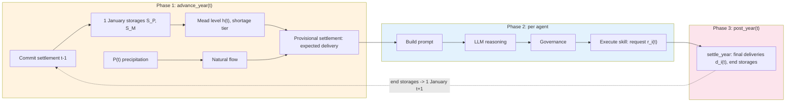

# Irrigation Water System: Physics Reference

Detailed mass balance equations, variable definitions, storage-elevation curves, and CRSS comparison for the irrigation ABM. This supplements the main [README](../README.md) Section 4.

---

## Mass Balance Equations

All quantities in MAF (million acre-feet), annual resolution. Supply-side redesign (2026-09-25): deliveries are limited by what the two reservoirs can physically supply, as in Hung and Yang (2021), whose agents receive the diversion CRSS delivers. Lake Powell is a storage buffer: a pass-through release with a 7.0 MAF floor supported by Powell storage; not the Interim Guidelines (no equalization or balancing release tiers, no Mead protection levels). The year's settlement, in order (`irrigation_env.py (IrrigationEnvironment._settle)`):

**1. Natural flow** (Lees Ferry long-term average 12 MAF; precipitation baseline 100 mm)

$$Q_{Nat} = 12 \times \frac{P_{winter}}{100}, \quad Q_{Nat} \in [6,\, 17] \;\text{MAF}$$

**2. Upper Basin delivery**: limited by the 5.0 MAF delivery capacity and by what leaves Lake Powell able to keep a 7.0 MAF release from inflow plus usable storage; shared pro-rata across Upper Basin agents

$$D_{UB} = \min\bigl(\textstyle\sum r_{UB},\; 5.0,\; Q_{Nat},\; \max(0,\; Q_{Nat} + (S_P - S_{P,dead}) - E_P - 7.0)\bigr)$$

A year with $Q_{Nat} < 7$ no longer zeroes the Upper Basin: storage covers the 7.0 MAF floor, and the Upper Basin is cut only when Powell's usable storage cannot.

**3. Lake Powell** (decision 2026-09-26, option c): the inflow $I_P = Q_{Nat} - D_{UB}$ passes through to Mead, as in the pre-redesign physics; only when that pass-through is below 7.0 MAF does storage above the dead pool top the release up to 7.0 MAF (or release what is available); storage above full pool spills into the release

$$A_P = \max(0,\; I_P + S_P - S_{P,dead} - E_P), \qquad R = \begin{cases} \min(I_P,\; A_P) & I_P \ge 7.0 \\ \min(7.0,\; A_P) & I_P < 7.0 \end{cases} + spill_P, \qquad S_P(t+1) = S_P(t) + I_P - E_P - R$$

In a normal year Powell storage only loses evaporation; nothing refills it, so over a long dry run it drains toward the dead pool (see the consequence note below).

**4. Lake Mead withdrawals**: the declared shortage cut $\gamma_\tau$ applies to the whole Lower Basin consumptive use (agricultural agents and the 5.0 MAF non-agricultural bucket); Mexico per Minute 323

$$O = \Bigl(\textstyle\sum r_{LB} + D_{muni}\Bigr)(1 - \gamma_\tau) + M_{DCP}(h)$$

**5. Lake Mead availability**: withdrawals cannot exceed storage above the dead pool plus the year's inflow; when they would, every Lower Basin withdrawal is scaled by the same $\phi$

$$A = (S_M - 2.0) + R + 1.0 - E_M, \qquad \phi = \min(1,\; A / O)$$

$$S_M(t+1) = S_M(t) + R + 1.0 - E_M - \phi\, O, \qquad S_M \le 26.1 \text{ (excess spills below Hoover)}$$

The former $\pm 3.5$ MAF clamp on the annual Mead storage change is retired (Powell storage now does the buffering, and the clamp broke mass conservation). Both balances close exactly:

$$\Delta S_P + \Delta S_M = Q_{Nat} + 1.0 - D_{UB} - E_P - E_M - \phi\, O - spill_M$$

(`tests/test_irrigation_supply_side.py (TestMassBalance)` checks this for 3,000 random states.)

**6. Agent delivery** ($r_i$ = request, capped at the water right $w_i$)

$$d_i = r_i \times \frac{D_{UB}}{\sum r_{UB}} \;\;(\text{Upper Basin}), \qquad d_i = r_i\,(1 - \gamma_\tau)\,\phi \;\;(\text{Lower Basin})$$

Each agent also carries a `gap_reason` code (`none`, `ub_capacity`, `ub_powell_release`, `lb_shortage_tier`, `lb_mead_availability`, or the last two joined by `+`), which the prompt and memory text turn into a sentence.

### Auxiliary Equations

**Evaporation** (storage as a surface-area proxy; taken on the 1 January storage and never below a dead pool):

$$E_M(S) = 0.8 \times \max\!\left(0.15,\; \min\!\left(\frac{S}{13.0},\; 1.50\right)\right), \qquad E_P(S) = 0.70 \times \max\!\left(0.15,\; \min\!\left(\frac{S}{26.21},\; 1\right)\right)$$

### Lake Powell constants and sources

All four values are TO VERIFY against the USBR/USGS originals: they were read from search results and a machine text extraction of the 24-Month Study PDF, and the code review could not open the sources.

| Constant | Value | Source |
| :------- | :---- | :----- |
| Total capacity at full pool (3,700 ft) | 26.21 MAF | 1986 area-capacity table (used by USBR operations through 2019). USGS (2022), "Lake Powell's storage capacity updated for first time since 1986": 25.160 MAF in the 2018 survey, a 1.048 MAF loss since 1986 |
| Dead-pool storage (below 3,370 ft) | 1.89 MAF | 26.21 MAF total minus 24.322 MAF live capacity (USBR Glen Canyon Dam data, 1986 table); reported as "about 1.9 MAF" |
| Storage on 1 January 2019 | 11.99 MAF total (10.099 MAF live) | USBR Lower Colorado Region, January 2019 24-Month Study (Most Probable), Lake Powell table: end of December 2018, 3,581.85 ft, 10,099 thousand acre-ft live |
| Evaporation at full pool | 0.70 MAF/yr | Same study: 386 thousand acre-ft in water year 2018 at about 12.5 MAF mean live storage (0.55 of capacity), so 0.386 / 0.55 |
| Minimum release | 7.0 MAF/yr | 2007 Interim Guidelines minimum objective release (existing constant) |

The 2018 survey gives about 1 MAF less capacity than the 1986 table; the model uses the 1986 table because the Dec 2018 storage it starts from was reported on that table.

---

## Variable Definitions

| Symbol | Definition | Value / Unit |
| :----- | :--------- | :----------- |
| $S_M$, $S_P$ | Lake Mead, Lake Powell total storage (1 January) | MAF |
| $h$ | Lake Mead elevation (USBR storage-elevation curve) | ft |
| $Q_{Nat}$ | Natural flow at Lees Ferry | MAF/yr |
| $P_{winter}$ | UB winter precipitation (7-state average) | mm |
| $D_{UB}$ | Upper Basin delivered total | MAF/yr |
| $R$ | Powell release to Mead | MAF/yr |
| $O$ | Scheduled Lower Basin withdrawals from Mead (after the tier cut) | MAF/yr |
| $A$ | Water Mead can deliver this year | MAF/yr |
| $\phi$ | Physical delivery ratio at Mead | [0, 1] |
| $D_{muni}$ | Municipal/M&I demand (CAP + MWD + losses) | 5.0 MAF/yr |
| $M_{DCP}(h)$ | Mexico treaty delivery (elevation-dependent, Minute 323) | MAF/yr |
| $E_M$, $E_P$ | Reservoir evaporation (storage-dependent) | MAF/yr |
| $r_i$ | Agent $i$ request (post-governance, capped at $w_i$) | AF/yr |
| $w_i$ | Agent $i$ water right (see note below) | AF/yr |
| $\gamma_\tau$ | Lower Basin shortage cut for tier $\tau$ (0, 0.05, 0.10, 0.20) | [0, 1] |
| $d_i$ | Agent $i$ delivered water (`diversion` in the code and logs) | AF/yr |

F10 (2026-09-25 audit): $w_i$ is `col.iloc[-1]` of that agent's
`Div_States/*_discrete_states.csv`, the TOP of the discretised FQL
diversion grid (Hung & Yang's `Div_max`), not a legal Colorado River
entitlement. Initial requests come from 2018 diversions, and most
agents' 2018 use sits well under that grid-top ceiling: 61 of 78 agents
(52 of 56 Upper Basin) start below 50% utilisation. See
`irrigation_personas.py:create_profiles_from_data`.

---

## Implementation Pseudocode

From `irrigation_env.py (IrrigationEnvironment.advance_year, settle_year, _settle)` and `run_experiment.py (IrrigationLifecycleHooks.post_year)`:

```text
advance_year(t)                          [before any agent decides]
  |-- 1. commit settlement(t-1): end storages -> 1 January storages of t
  |        (settles now at the final requests if settle_year() was never called)
  |-- 2. _generate_precipitation()          <- P_winter from CRSS PRISM (UB 7-state avg)
  |        Q_Nat = 12.0 * (P / 100)          [bounded 6-17 MAF]
  |-- 3. h(t) = elevation(S_M on 1 January) <- appended to the Mead history
  |-- 4. _update_preceding_factors(), _compute_drought_index()
  |-- 5. _apply_curtailment()               <- shortage tier from h(t); gamma on LB agents, 0 on UB
  |-- 6. freeze the 1 January snapshot; PROVISIONAL _settle() at the carried requests
  |        -> each agent's expected delivery, delivery_ratio, gap_reason
  +-- 7. total_basin_demand, basin_request_over_target (= total / 5.86 MAF)
decisions                                 execute_skill -> update_agent_request
post_year(t) -> settle_year()             FINAL _settle() at this year's requests, from the
                                          frozen snapshot; idempotent; not committed until t+1
```

---

## Mexico DCP Reductions (Minute 323)

When Lake Mead elevation drops, Mexico voluntarily reduces delivery:

| Mead Elevation | Mexico Reduction | Effective Delivery |
| :------------- | :--------------- | :----------------- |
| >= 1090 ft | 0 | 1.500 MAF |
| 1075-1090 ft | 0.041 MAF | 1.459 MAF |
| 1050-1075 ft | 0.080 MAF | 1.420 MAF |
| 1025-1050 ft | 0.104 MAF | 1.396 MAF |
| < 1025 ft | 0.275 MAF | 1.225 MAF |

---

## Storage-Elevation Curve

Lake Mead storage-to-elevation is interpolated from the USBR 2009 area-capacity survey (9 control points hardcoded in `irrigation_env.py` as `_STORAGE_MAF` and `_ELEVATION_FT`).

---

## Agent-Reservoir Feedback Loop



| Step | Equation | Constants |
| :--- | :------- | :-------- |
| 1 Natural flow | $Q_{Nat} = 12 \times P_{winter}/100$ | bounded [6, 17] MAF |
| 2 Upper Basin delivery | $D_{UB} = \min(\sum r_{UB}, 5.0, Q_{Nat}, \max(0, Q_{Nat} + S_P - S_{P,dead} - E_P - 7.0))$ | pro-rata |
| 3 Powell | $S_P' = S_P + Q_{Nat} - D_{UB} - E_P - R$; $R = Q_{Nat} - D_{UB}$ (pass-through), topped up from storage to 7.0 MAF when lower, capped so storage stays at or above the dead pool | dead pool 1.89, capacity 26.21 MAF |
| 4 Mead withdrawals | $O = (\sum r_{LB} + 5.0)(1 - \gamma_\tau) + M_{DCP}(h)$ | tier cut on the whole Lower Basin |
| 5 Mead | $S_M' = S_M + R + 1.0 - E_M - \phi O$, $\phi = \min(1, A/O)$ | $S_M \in [2.0, 26.1]$ |
| 6 Delivery | $d_i = r_i D_{UB}/\sum r_{UB}$ (UB), $r_i(1-\gamma_\tau)\phi$ (LB) | |

**Feedback loop**: Over-extraction lowers Mead, a lower 1 January level declares a higher tier, the Lower Basin cut grows and Lower Basin increases are blocked, requests level off or fall, Mead recovers, the tier drops. Requests made in year $t$ are settled in year $t$; their effect on storage is seen by agents on 1 January of $t+1$.

---

## Comparison with Full CRSS

| Aspect | Our Model | Full CRSS |
| :----- | :-------- | :-------- |
| Temporal resolution | Annual | Monthly |
| Spatial resolution | 2 basins (UB/LB) | 3,700+ objects |
| Reservoir model | Powell and Mead storage stocks | Powell + Mead + Flaming Gorge + ... |
| Operating rules | Powell pass-through release with a 7.0 MAF floor; Mead shortage tiers (simplified DCP) | Full Interim Guidelines + DCP + Minute 323 |
| Demand model | 78 LLM agents | Exogenous demand schedules |
| Precipitation | CRSS PRISM (real) | CRSS PRISM (same source) |
| Natural flow | Scaled by precip | Full hydrologic routing |
| Agent feedback | Bidirectional | None (exogenous demand) |

**Key advantage**: Bidirectional coupling (agent demand <-> reservoir state) enables studying how governance rules affect collective demand trajectories, something standard CRSS cannot do because it uses fixed exogenous demand schedules.

---

## Two-Reservoir Simplification (what is and is not modelled)

Before the 2026-09-25 supply-side redesign the model tracked Lake Mead only: the Powell release was natural flow minus Upper Basin use, the 7.0 MAF minimum release was enforced by capping Upper Basin use at $\max(0, Q_{Nat} - 7)$ (so every Upper Basin agent received 0 in a 6.0 MAF year such as 2022, audit finding F11), and a $\pm 3.5$ MAF clamp on the annual Mead storage change stood in for Glen Canyon buffering. F11b (same day) made that cap survive each agent's own decision by re-applying it once after the decision loop.

The redesign keeps the F11b pattern (one idempotent settlement after the decision loop, rebuilt from requests and a frozen 1 January snapshot) and replaces the physics:

* Lake Powell is a storage stock between 1.89 MAF (dead pool) and 26.21 MAF (full pool), starting from the USBR end-of-2018 storage. It passes its inflow through to Mead; when that is below 7.0 MAF, storage above the dead pool tops the release up to 7.0 MAF (or releases what is available). It spills above full pool.
* Upper Basin use is cut only when Powell's usable storage cannot cover the 7.0 MAF floor, and then pro-rata, not to zero.
* Lake Mead deliveries cannot exceed its usable storage plus inflow; when they would, all Lower Basin withdrawals are scaled pro-rata.
* Mead shortage tiers apply to the Lower Basin only (Law of the River), to the whole Lower Basin consumptive use including the 5.0 MAF non-agricultural bucket.
* The $\pm 3.5$ MAF clamp is retired; mass balance closes.

Not modelled, on purpose (simplification to disclose): the Interim Guidelines Powell release tiers (equalization, upper and mid elevation balancing, 7.48 / 8.23 MAF releases), Lake Mead protection levels, Drought Response Operations, and Flaming Gorge.

**Consequence to disclose (measured 2026-09-26, 2018 requests held fixed for 42 years on the CRSS PRISM series).** Old = the pre-redesign Mead-only balance (fcd74a5f); first version = the redesign with the release pinned at 7.0 MAF (fe72e43f, replaced by option c).

| Physics | Years at Tier 2 or 3 | Mean 1 January Mead | Minimum | 2020 tier |
| :------ | :------------------- | :------------------ | :------ | :-------- |
| Old (Mead only) | 3 of 42 | 1121 ft | 1006 ft | 1 (its level series is end-of-year, one year earlier than the 1 January series) |
| Release pinned at 7.0 MAF (first version) | 24 of 42 | 1053 ft | 1016 ft | 1 |
| Pass-through with a 7.0 MAF floor (current) | 3 of 42 | 1132 ft | 1026 ft | 0 |

Option (c) sits close to the old physics in normal years. The difference is in dry years, where storage keeps the release at 7.0 MAF and the Upper Basin is not cut. But nothing refills Powell, because in a normal year the whole inflow passes through: storage falls by evaporation every year and by the top-up in dry years. At fixed 2018 requests Powell reaches its dead pool in 2031. From then on it behaves like the old physics (Upper Basin cut pro-rata whenever natural flow minus Upper Basin use is below 7.0 MAF): 14 of 42 years with an Upper Basin cut, as deep as 14 percent of the request delivered in 2058. The drain is mostly the dry-year top-ups: up to 2031, top-ups take 8.06 MAF out of Powell storage and evaporation 2.04 MAF. With Powell evaporation set to 0 (sensitivity) Powell still reaches its dead pool, one year later (2032), with 12 Upper Basin cut years; the Mead side barely moves (2 years at Tier 2 or 3, mean 1137 ft). At full water-right requests: Tier 2 or 3 in 39 of 42 years, mean 996 ft (old: 40, 976 ft), Mead minimum 895 ft (dead pool) in both.

### Initial State: Mead 1081.46 ft, Powell 11.99 MAF (1 January 2019)

Lake Mead starts at 1081.46 ft, the USBR-observed elevation at the end of December 2018 (Y1 = calendar year 2019), which places loop year 1 in Tier 0. The Mead elevation history is a 1 January series seeded with 1082.52 ft (1 January 2018), so loop year 1's rising/declining flag compares 1081.46 ft against 1082.52 ft. Lake Powell starts at 11.99 MAF total (10.099 MAF live, 3,581.85 ft), from the January 2019 24-Month Study.

---

## Data Sources

| Data | Source | File |
| :--- | :----- | :--- |
| Winter precipitation (2017-2060) | CRSS/PRISM NOAA projection | `ref/CRSS_DB/CRSS_DB/HistoricalData/PrismWinterPrecip_ST_NOAA_Future.csv` |
| Agent water rights (78 agents) | Top of each agent's discretised FQL diversion grid (Hung & Yang's `Div_max`); not a legal entitlement, see the F10 note above | `ref/CRSS_DB/CRSS_DB/Div_States/UB_discrete_states.csv`, `.../LB_discrete_states.csv` |
| Historical UB depletion | CRSS (2018 baseline) | `ref/CRSS_DB/CRSS_DB/HistoricalData/UB_historical_annual_depletion.csv` |
| Historical LB diversion | CRSS (2018 baseline) | `ref/CRSS_DB/CRSS_DB/HistoricalData/LB_historical_annual_diversion.csv` |
| Lake Mead storage-elevation | USBR 2009 area-capacity survey | Hardcoded in `irrigation_env.py` (`_STORAGE_MAF`, `_ELEVATION_FT`) |
| Lake Powell capacity, dead pool, 1 January 2019 storage, evaporation | USGS (2022) capacity release; USBR January 2019 24-Month Study | `WaterSystemConfig` (see the Lake Powell constants table above) |
| FQL calibrated parameters | Hung & Yang (2021) Table 2 | Embedded in `config/agent_types.yaml` under `fql_reference` |

**Precipitation as sole exogenous forcing**: The PRISM CSV contains annual winter precipitation projections for 9 Upper Basin state-groups (WY, UT1-3, NM, CO1-3, AZ), generated by CRSS via bootstrapping from the 1906-2018 historical PRISM/NOAA record. Values are in inches, converted to mm (*25.4) at load time. The UB 7-state average drives the natural flow calculation (Eq. 1). All other quantities are computed endogenously.
