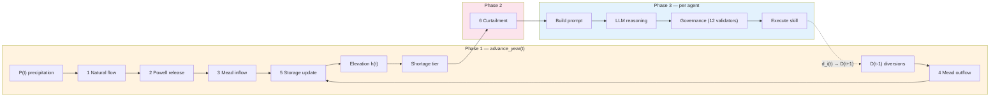

# Irrigation Water System — Physics Reference

Detailed mass balance equations, variable definitions, storage-elevation curves, and CRSS comparison for the irrigation ABM. This supplements the main [README](../README.md) Section 4.

---

## Mass Balance Equations

All quantities in MAF (million acre-feet), annual resolution. The system computes sequentially:

**1. Natural flow** — Lee Ferry long-term average: 12 MAF; precipitation baseline: 100 mm

$$Q_{Nat} = 12 \times \frac{P_{winter}}{100}, \quad Q_{Nat} \in [6,\, 17] \;\text{MAF}$$

**2. Water release from Lake Powell** — min release: 7.0 MAF floor via UB diversion cap; no max release ceiling

$$Q_{Powell}(t) = Q_{Nat} - Div\_UB_{effective}, \qquad Div\_UB_{effective} = \min\bigl(Div\_UB,\; \max(0,\, Q_{Nat} - 7.0),\, Cap_{infra}\bigr)$$

**3. Inflow of Lake Mead** — streamflow from tributaries: 1 MAF

$$Q_{in,Mead} = Q_{Powell} + 1.0$$

**4. Outflow of Lake Mead** — $D_{muni}$ = 5.0 MAF (CAP + MWD + municipal); $M_{DCP}(h)$ = Mexico treaty (elevation-dependent); $ET(S)$ = evaporation

$$Q_{out,Mead} = D_{muni} + M_{DCP}(h) + ET(S) + \sum_{i=1}^{n} Div\_LB_{i,t}$$

**5. Storage update** — Glen Canyon Dam buffering limits $|\Delta S| \leq 3.5$ MAF/yr

$$S(t+1) = S(t) + Q_{in,Mead} - Q_{out,Mead}, \quad S \in [2.0,\; 26.1]$$

**6. Agent diversion** — $r_i$ = demand request, $w_i$ = water right, $\gamma_\tau$ = curtailment ratio for tier $\tau$

$$d_i(t) = \min(r_i(t),\; w_i) \times (1 - \gamma_\tau)$$

### Auxiliary Equations

**Evaporation** — scales with storage as surface-area proxy ($E_{ref}$ = 0.8 MAF/yr at $S_{ref}$ = 13.0 MAF):

$$ET(S) = E_{ref} \times \max\!\left(0.15,\; \min\!\left(\frac{S}{S_{ref}},\; 1.50\right)\right)$$

---

## Variable Definitions

| Symbol | Definition | Value / Unit |
| :----- | :--------- | :----------- |
| $S$ | Lake Mead storage | MAF |
| $h$ | Lake Mead elevation (USBR storage-elevation curve) | ft |
| $Q_{Nat}$ | Natural flow at Lee Ferry | MAF/yr |
| $P_{winter}$ | UB winter precipitation (7-state average) | mm |
| $Q_{Powell}$ | Powell release to Mead | MAF/yr |
| $Q_{raw}$ | Unconstrained Powell release (before min/max clamp) | MAF/yr |
| $Q_{in,Mead}$ | Total Mead inflow | MAF/yr |
| $Q_{out,Mead}$ | Total Mead outflow | MAF/yr |
| $Div\_UB_{i,t}$ | Upper Basin agent $i$ diversion in year $t$ | MAF/yr |
| $Div\_LB_{i,t}$ | Lower Basin agent $i$ diversion in year $t$ | MAF/yr |
| $D_{muni}$ | Municipal/M&I demand (CAP + MWD + losses) | 5.0 MAF/yr |
| $M_{DCP}(h)$ | Mexico treaty delivery (elevation-dependent, Minute 323) | MAF/yr |
| $ET(S)$ | Reservoir evaporation (storage-dependent) | MAF/yr |
| $r_i$ | Agent $i$ demand request (post-governance) | AF/yr |
| $w_i$ | Agent $i$ water right (see note below) | AF/yr |
| $\gamma_\tau$ | Curtailment ratio for shortage tier $\tau$ | dimensionless |
| $d_i$ | Agent $i$ actual diversion (after curtailment) | AF/yr |

F10 (2026-09-25 audit): $w_i$ is `col.iloc[-1]` of that agent's
`Div_States/*_discrete_states.csv`, the TOP of the discretised FQL
diversion grid (Hung & Yang's `Div_max`), not a legal Colorado River
entitlement. Initial requests come from 2018 diversions, and most
agents' 2018 use sits well under that grid-top ceiling: 61 of 78 agents
(52 of 56 Upper Basin) start below 50% utilisation, so
`demand_floor_stabilizer` (`DEMAND_FLOOR_RATIO = 0.50`) binds for most
agents from year 1 in the governed arm, not only in years where drought
or curtailment pushes usage down. See
`irrigation_personas.py:create_profiles_from_data`.

---

## Implementation Pseudocode

From `irrigation_env.py:725-804`:

```text
advance_year()
  |-- 1. _generate_precipitation()          <- P_winter from CRSS PRISM (UB 7-state avg)
  |-- 2. _generate_lake_mead_level()        <- Steps 1-5 above
  |        Q_Nat    = 12.0 * (P / 100)              [bounded 6-17 MAF]
  |        Div_UB_eff = min(sum(Div_UB), max(0.0, Q_Nat - 7.0), 5.0)
  |        Q_Powell = Q_Nat - Div_UB_eff            [7.0 floor via UB cap only when Q_Nat >= 7.0; no max release ceiling]
  |        Q_in     = Q_Powell + 1.0                 [tributaries]
  |        Q_out    = sum(Div_LB) + M_DCP(h) + ET(S) + 5.0
  |        delta    = clip(Q_in - Q_out, -3.5, 3.5)  [Glen Canyon buffering +/-3.5 MAF/yr]
  |        S(t+1)   = clip(S(t) + delta, 2.0, 26.1)
  |        h        = USBR storage-elevation lookup(S)
  |-- 3. _update_preceding_factors()        <- Binary: did precip/Mead rise?
  |-- 4. _compute_drought_index()           <- Composite severity index
  |-- 5. _apply_curtailment()               <- d_i = min(r_i, w_i) * (1 - gamma_tau)
  +-- 6. _apply_powell_constraint()         <- Pro-rata UB scaling
```

---

## Mexico DCP Reductions (Minute 323)

When Lake Mead elevation drops, Mexico voluntarily reduces delivery:

| Mead Elevation | Mexico Reduction | Effective Delivery |
| :------------- | :--------------- | :----------------- |
| >= 1090 ft | 0 | 1.500 MAF |
| 1075-1090 ft | 0.041 MAF | 1.459 MAF |
| 1050-1075 ft | 0.080 MAF | 1.420 MAF |
| 1025-1050 ft | 0.104 MAF | 1.396 MAF |
| < 1025 ft | 0.275 MAF | 1.225 MAF |

---

## Storage-Elevation Curve

Lake Mead storage-to-elevation is interpolated from the USBR 2009 area-capacity survey (9 control points hardcoded in `irrigation_env.py` as `_STORAGE_MAF` and `_ELEVATION_FT`).

---

## Agent-Reservoir Feedback Loop



| Step | Equation | Constants |
| :--- | :------- | :-------- |
| 1 Natural flow | $Q_{Nat} = 12 \times P_{winter}/100$ | bounded [6, 17] MAF |
| 2 Powell release | $Q_{Powell} = \max(7, \min(Q_{raw}, 12))$ | $Q_{raw} = Q_{Nat} - \sum Div\_UB$ |
| 3 Mead inflow | $Q_{in} = Q_{Powell} + 1.0$ | tributaries: 1 MAF |
| 4 Mead outflow | $Q_{out} = D_{muni} + M_{DCP}(h) + ET(S) + \sum Div\_LB$ | $D_{muni}$ = 5.0 MAF |
| 5 Storage update | $S(t+1) = S(t) + Q_{in} - Q_{out}$ | $S \in [2.0, 26.1]$, $\|\Delta S\| \leq 3.5$ |
| 6 Curtailment | $d_i = \min(r_i, w_i) \times (1 - \gamma_\tau)$ | tier-dependent $\gamma$ |

**Feedback loop**: Over-extraction → lower Mead → higher tier → larger curtailment + governance blocks increases → agents shift to maintain/decrease → demand drops → Mead recovers → tier drops → constraints relax. The dashed arrow represents the one-year lag: $d_i(t)$ becomes $D(t+1)$ in next year's mass balance.

---

## Comparison with Full CRSS

| Aspect | Our Model | Full CRSS |
| :----- | :-------- | :-------- |
| Temporal resolution | Annual | Monthly |
| Spatial resolution | 2 basins (UB/LB) | 3,700+ objects |
| Reservoir model | Single (Mead) | Powell + Mead + Flaming Gorge + ... |
| Operating rules | Simplified DCP | Full LROC + DCP + Minute 323 |
| Demand model | 78 LLM agents | Exogenous demand schedules |
| Precipitation | CRSS PRISM (real) | CRSS PRISM (same source) |
| Natural flow | Scaled by precip | Full hydrologic routing |
| Agent feedback | Bidirectional | None (exogenous demand) |

**Key advantage**: Bidirectional coupling (agent demand <-> reservoir state) enables studying how governance rules affect collective demand trajectories — something standard CRSS cannot do because it uses fixed exogenous demand schedules.

---

## Single-Reservoir Justification

The Colorado River system has two major reservoirs — Lake Powell (upstream, Glen Canyon Dam) and Lake Mead (downstream, Hoover Dam) — but our model tracks only Lake Mead explicitly. Three reasons:

1. **Lake Mead is the decision-relevant reservoir.** All DCP shortage tiers, curtailment ratios, and Mexico treaty reductions are triggered by Lake Mead elevation. Lake Powell's operational role is to regulate releases to Lake Mead, captured through the Powell minimum release constraint (Eq. 5) and the UB infrastructure ceiling.

2. **Powell is implicitly represented.** The code calculates `powell_release = natural_flow - ub_div_effective` (`irrigation_env.py:936-949`), where Upper Basin diversions are clamped at `ub_div_effective = min(ub_div_maf, max(0.0, natural_flow - 7.0), 5.0)`. This enforces a 7.0 MAF/yr minimum-release floor from Lake Powell whenever natural flow is at or above 7.0 MAF/yr (by restricting Upper Basin diversions rather than clamping release directly). Downstream, Glen Canyon Dam buffering caps the annual Lake Mead storage change at $\pm 3.5$ MAF/yr (`irrigation_env.py:981-983`). A 12 MAF/yr maximum release is NOT implemented; earlier versions of this document stated it was (corrected 2026-09-16).

3. **Hung & Yang (2021) uses the same approach.** Their FQL model also uses a reduced-form mass balance with CRSS inputs rather than independent Powell modeling.

**F11 (2026-09-25 audit, disclosure only, no behaviour change):** because
Powell *storage* is not modelled (only its minimum-release floor, item 2
above), a year where natural flow drops below 7.0 MAF has no storage
buffer to draw down instead: Upper Basin diversions are scaled to
exactly 0 for that year rather than partially reduced, immediately after
`_apply_powell_constraint` runs. In the CRSS PRISM series this happens
in 2022 (`_generate_lake_mead_level` / `_apply_powell_constraint` in
`irrigation_env.py`). This zero is what the agent's own prompt and every
governance check see, since both read state before that agent's
decision executes.

**Code review note (2026-09-25, found reviewing a later branch, not
fixed here, corrected in a second review pass the same day):** the zero
does not survive that agent's own decision. `update_agent_request`
recomputes diversion from `curtailment_ratio` alone, with no Powell
scale factor, and every skill (`maintain_demand` included) calls it, so
the zero (and any lesser Powell scaling, not only the full-zero case) is
overwritten the instant that agent acts.

The first version of this note also claimed the Mead mass balance never
sees the Powell zero. That overstated it: `_generate_lake_mead_level`
recomputes its own Upper-Basin cap from that year's own natural flow
every time it runs, independent of whatever `update_agent_request` did
to `agent["diversion"]` afterward, so the reservoir physics does
re-derive and re-apply the Powell cap each year rather than trusting a
possibly-stale value. It reads Upper Basin diversions from the
*previous* year by design, so a year whose own natural flow is not
restrictive can still carry forward an inflated prior-year total if that
prior year's own cap did not happen to bind again when read. What
reliably loses the cap, with no independent re-derivation to fall back
on, is narrower: `simulation_log.csv`'s `diversion` column, this
branch's F05 memory snapshot, and `_batch_reflect`'s `supply_ratio` all
read `agent["diversion"]` directly. See `_apply_powell_constraint`'s
docstring in `irrigation_env.py` for the full detail; whether
`update_agent_request` should also apply a Powell scale factor is a
design decision for the runner/env owner.

Lower Basin diversions are governed separately by the tier-based
curtailment ratios in `_apply_curtailment`, which floor at 0.80 of
requested (Tier 3's 20% cut) by construction, so they cannot reach zero
through this path and are not affected by the gap above. Consequently
`supply_gap_block_increase` and the `non_negative_diversion` governance
warning, which validate before the agent's decision executes, are still
reachable only for Upper Basin agents in this model; Lower Basin agents
never trigger them.

### Initial Elevation: 1081.46 ft (Dec 2018 Observed)

The simulation initializes Lake Mead at 1081.46 ft, the USBR-observed elevation as of December 2018 — the year before the simulation begins (Y1 = calendar year 2019). This places the initial condition in Tier 0 (above the 1075 ft threshold). The code also pre-seeds the elevation history with 2017 (1082.52 ft) and 2018 (1081.46 ft) values for the preceding-factor computation requiring a 2-year lookback.

---

## Data Sources

| Data | Source | File |
| :--- | :----- | :--- |
| Winter precipitation (2017-2060) | CRSS/PRISM NOAA projection | `ref/CRSS_DB/CRSS_DB/HistoricalData/PrismWinterPrecip_ST_NOAA_Future.csv` |
| Agent water rights (78 agents) | Top of each agent's discretised FQL diversion grid (Hung & Yang's `Div_max`); not a legal entitlement, see the F10 note above | `ref/CRSS_DB/CRSS_DB/Div_States/UB_discrete_states.csv`, `.../LB_discrete_states.csv` |
| Historical UB depletion | CRSS (2018 baseline) | `ref/CRSS_DB/CRSS_DB/HistoricalData/UB_historical_annual_depletion.csv` |
| Historical LB diversion | CRSS (2018 baseline) | `ref/CRSS_DB/CRSS_DB/HistoricalData/LB_historical_annual_diversion.csv` |
| Lake Mead storage-elevation | USBR 2009 area-capacity survey | Hardcoded in `irrigation_env.py` (`_STORAGE_MAF`, `_ELEVATION_FT`) |
| FQL calibrated parameters | Hung & Yang (2021) Table 2 | Embedded in `config/agent_types.yaml` under `fql_reference` |

**Precipitation as sole exogenous forcing**: The PRISM CSV contains annual winter precipitation projections for 9 Upper Basin state-groups (WY, UT1-3, NM, CO1-3, AZ), generated by CRSS via bootstrapping from the 1906-2018 historical PRISM/NOAA record. Values are in inches, converted to mm (*25.4) at load time. The UB 7-state average drives the natural flow calculation (Eq. 6). All other quantities are computed endogenously.
